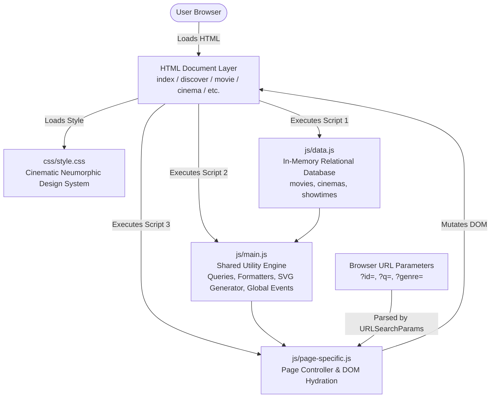
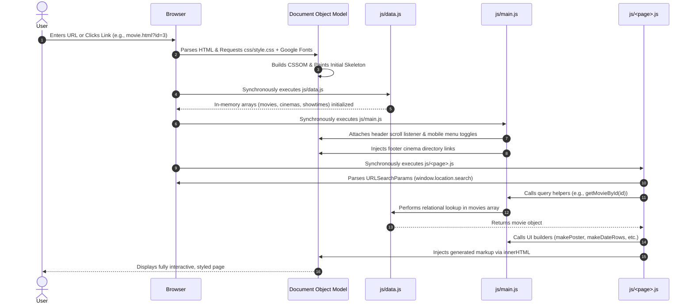
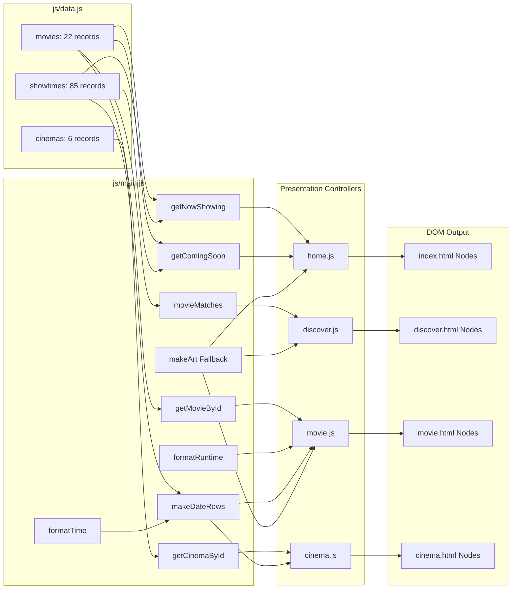

# CineSphere — Comprehensive Project Analysis & University Viva Examination Guide

> **Academic Course Project**: Web Technology / Human-Computer Interaction / Front-End Web Engineering  
> **Application Name**: CineSphere  
> **Scope**: Film Discovery & Multiplex Screening Guide for Lahore, Pakistan  
> **Core Architecture**: Zero-Dependency Semantic HTML5, Vanilla CSS3 (Cinematic Neumorphism), Modular Vanilla JavaScript (ES6+)  
> **Deliverable**: Definitive Codebase Analysis & Complete Viva Defense Guide

---

# Table of Contents

1. [Project Overview](#1-project-overview)
2. [Technologies and Dependencies](#2-technologies-and-dependencies)
3. [Complete Project Directory Structure](#3-complete-project-directory-structure)
4. [Project Architecture](#4-project-architecture)
5. [Application Execution Flow](#5-application-execution-flow)
6. [File-by-File Detailed Explanation](#6-file-by-file-detailed-explanation)
   - [`index.html`](#file-indexhtml)
   - [`discover.html`](#file-discoverhtml)
   - [`now-showing.html`](#file-now-showinghtml)
   - [`coming-soon.html`](#file-coming-soonhtml)
   - [`cinemas.html`](#file-cinemashtml)
   - [`cinema.html`](#file-cinemahtml)
   - [`movie.html`](#file-moviehtml)
   - [`404.html`](#file-404html)
   - [`css/style.css`](#file-cssstylecss)
   - [`js/data.js`](#file-jsdatajs)
   - [`js/main.js`](#file-jsmainjs)
   - [`js/home.js`](#file-jshomejs)
   - [`js/discover.js`](#file-jsdiscoverjs)
   - [`js/now-showing.js`](#file-jsnow-showingjs)
   - [`js/coming-soon.js`](#file-jscoming-soonjs)
   - [`js/cinemas.js`](#file-jscinemasjs)
   - [`js/cinema.js`](#file-jscinemajs)
   - [`js/movie.js`](#file-jsmoviejs)
   - [`README.md`](#file-readmemd)
   - [`design-system/cinesphere/MASTER.md`](#file-design-systemcinespheremastermd)
7. [Important Programming Concepts](#7-important-programming-concepts)
8. [Complete Feature and Functionality Explanation](#8-complete-feature-and-functionality-explanation)
9. [UI and Styling Explanation](#9-ui-and-styling-explanation)
10. [Data Flow and Internal Working](#10-data-flow-and-internal-working)
11. [Important Functions and Code Tracing](#11-important-functions-and-code-tracing)
12. [API and External Integrations](#12-api-and-external-integrations)
13. [Configuration and Environment Variables](#13-configuration-and-environment-variables)
14. [Limitations, Bugs, and Incomplete Features](#14-limitations-bugs-and-incomplete-features)
15. [Comprehensive Viva Question Bank](#15-comprehensive-viva-question-bank)
16. [Tricky and Scenario-Based Questions](#16-tricky-and-scenario-based-questions)
17. [Practical Code-Tracing Exercises](#17-practical-code-tracing-exercises)
18. [Project Presentation and Demonstration Script](#18-project-presentation-and-demonstration-script)
19. [Quick Revision Notes](#19-quick-revision-notes)
20. [Final Viva Preparation Checklist](#20-final-viva-preparation-checklist)

---

# 1. Project Overview

### 1.1 Purpose and Real-World Context
**CineSphere** is a centralized cinema guide and film discovery web application engineered specifically for the metropolitan cinema landscape of **Lahore, Pakistan**.

In Lahore, moviegoers frequently face a fragmented discovery experience:
- Multiplexes (such as Cinepax Packages Mall, Universal Cinemas Emporium Mall, CineStar Xinhua/Township/DHA Raya, and Raiha CineGold Plex) operate disconnected websites or rely on social media announcements.
- Comparing film formats (such as IMAX, 3D, 2D, 4DX, and Dolby Atmos) across different venues requires visiting multiple separate platforms.
- Finding upcoming releases, localized screening times, and language/subtitle options is cumbersome.

CineSphere solves this problem by providing a single, unified, aesthetically refined portal where users can:
1. Discover films currently showing or scheduled for release.
2. Filter and search titles in real time by keywords, genres, directors, and actors.
3. Inspect detailed screening timetables grouped by date and cinema.
4. Locate theaters across Lahore with verified addresses and direct outbound links to official booking sites.

### 1.2 Zero-Dependency Architecture
A core engineering decision of CineSphere is its **zero-dependency, framework-free implementation**:
- Built strictly with semantic **HTML5**, modern **Vanilla CSS3**, and **Vanilla ECMAScript 6+ (ES6)**.
- **No client-side frameworks** (no React, Angular, Vue, Svelte).
- **No styling frameworks** (no Tailwind, Bootstrap, Sass, Less).
- **No utility libraries** (no jQuery, Lodash, Moment.js, Axios).
- **No build steps or bundlers** (no Webpack, Vite, Parcel, Rollup, Babel, npm, or node_modules).

#### Why this approach is academically and technically superior for this project:
1. **Mastery of Web Fundamentals**: It proves thorough understanding of the Document Object Model (DOM), browser event lifecycles, CSS Box Model, CSS Grid, Flexbox, asynchronous UI events, and native data structures without framework abstractions.
2. **Instant Loading & Zero Overhead**: The entire codebase executes natively in the browser engine without parsing multi-megabyte JavaScript bundles.
3. **Extreme Portability**: The project runs seamlessly off the local filesystem simply by opening `index.html` in any browser or launching a zero-configuration web server (`python3 -m http.server 8000`).

### 1.3 Content Honesty & Demonstration Boundaries
In an academic viva, examiners look for honesty regarding what is real versus what is simulated:
- **Real Film Metadata**: Film titles, release years, genres, directors, cast rosters, plot overviews, and runtimes represent authentic cinematic releases (sourced and formatted from TMDB).
- **Real Cinema Data**: Multiplex names, areas (Johar Town, Walton Road, Gulberg III, DHA, Bahria Town), physical addresses, and official URLs reflect real commercial cinemas in Lahore.
- **Demonstration Screening Data**: The `showtimes` records (dates, times, seat availability states) are **seed demonstration data** created to prove the relational aggregation and formatting algorithms. **There is no live payment gateway or cinema ticketing API integration.**
- **Artwork**: Movie posters and backdrop images are stored locally in `.webp` format. If any image asset is absent, CineSphere includes a built-in mathematical procedural SVG fallback engine that dynamically renders genre-colored vector landscapes.
- **TMDB Attribution**: CineSphere uses TMDB metadata under fair educational use but is not endorsed or certified by TMDB.

---

# 2. Technologies and Dependencies

| Layer | Technology | Version / Specification | Role in CineSphere |
|---|---|---|---|
| **Structure** | Semantic HTML5 | W3C Living Standard | Accessible document structure, landmarks (`<header>`, `<nav>`, `<main>`, `<section>`, `<article>`, `<dl>`, `<footer>`), forms, and buttons. |
| **Styling** | Vanilla CSS3 | Modern CSS Specification | Custom Neumorphic design system, CSS Variables (`:root`), CSS Grid, Flexbox, transitions, media queries, accessibility overrides. |
| **Behavior** | Vanilla JavaScript | ECMAScript 2015+ (ES6+) | Relational data querying, DOM manipulation, real-time live search, event handling, carousel logic, URL parameter routing. |
| **Typography** | Google Fonts CDN | External Webfonts | `Playfair Display` (500, 600, italic) for high-contrast editorial titles; `Inter` (400, 500, 600) for UI controls, body copy, and metadata. |
| **Performance CDN** | `fonts.googleapis.com` | Preconnect & DNS-Prefetch | Minimizes round-trip network latency when fetching typography. |
| **Favicon** | SVG Data URI | Inline XML Vector | Embedded in `<head>` via `data:image/svg+xml,...` to render a red camera/reel icon without an external `.ico` file. |

### Configuration Manifests & Dependency Management
- **No `package.json`**: Because no third-party packages or build scripts are used, there is no `package.json` or `node_modules` directory.
- **Zero Third-Party Runtime Scripts**: The browser downloads zero external JavaScript libraries. Every script executed is author-written code located in `js/`.

---

# 3. Complete Project Directory Structure

```
CineSphere/
│
├── index.html                      # Landing page: cover hero carousel, now showing rail, upcoming, editor's pick, cinemas
├── discover.html                   # Catalog: real-time search, genre filter chips, sorting dropdown, poster grid
├── now-showing.html                # Filtered catalog: only films with active Lahore screenings + genre filter
├── coming-soon.html                # Release calendar: films releasing after today with zero active screenings
├── cinemas.html                    # Directory: list of Lahore multiplexes with real-time text filter
├── cinema.html                     # Dynamic single cinema view: showtimes grouped by movie for a specific cinema ?id=
├── movie.html                      # Dynamic single film view: facts, trailer link, format breakdown, cinema showtimes ?id=
├── 404.html                        # Fallback error page: friendly message and recovery button for nonexistent routes
├── README.md                       # High-level project documentation, execution instructions, and data disclosures
├── VIVA_GUIDE.md                   # This definitive comprehensive viva preparation & architectural defense document
│
├── css/
│   └── style.css                   # Complete unified stylesheet (1,205 lines) divided into 11 numbered sections
│
├── js/
│   ├── data.js                     # In-memory relational database: movies[], cinemas[], showtimes[]
│   ├── main.js                     # Core utility engine: lookups, formatters, procedural SVG generator, global UI events
│   ├── home.js                     # Controller for index.html: carousel, horizontal rail, editor's pick, cinema rows
│   ├── discover.js                 # Controller for discover.html: multi-criteria search, genre chips, sorting, empty states
│   ├── now-showing.js              # Controller for now-showing.html: genre filtering for active screening titles
│   ├── coming-soon.js              # Controller for coming-soon.html: upcoming release calendar cards
│   ├── cinemas.js                  # Controller for cinemas.html: real-time multi-field cinema filtering
│   ├── cinema.js                   # Controller for cinema.html: URL parameter ?id= ingestion, movie showtimes renderer
│   └── movie.js                    # Controller for movie.html: URL parameter ?id= ingestion, facts panel, showtime groups
│
├── assets/
│   ├── posters/                    # 2:3 aspect ratio WebP poster graphics for film cards and sidebars
│   │   ├── alien-romulus.webp
│   │   ├── deadpool-wolverine.webp
│   │   ├── dune-part-two.webp
│   │   └── ... (22 film posters)
│   └── backdrops/                  # 16:9 widescreen WebP banners for hero carousels and detail backdrops
│       ├── alien-romulus.webp
│       ├── deadpool-wolverine.webp
│       ├── dune-part-two.webp
│       └── ... (22 film backdrops)
│
└── design-system/
    └── cinesphere/
        ├── MASTER.md               # Design tokens, contrast measurements, neumorphic lighting model specification
        ├── MASTER.generated.md     # Raw design system generator output
        ├── MASTER.previous.md      # Earlier flat editorial design system draft
        └── pages/                  # Historical page-level styling notes from earlier design iterations
```

### Exclusions Notice:
- `assets/posters/` and `assets/backdrops/` are static image assets.
- `design-system/cinesphere/pages/` contains superseded historical notes (as documented in `MASTER.md`, `MASTER.md` takes absolute precedence).

---

# 4. Project Architecture

CineSphere implements a **Multi-Page Application (MPA) Architecture with Dynamic Client-Side Hydration and In-Memory Relational State**.



### 4.1 The Three-Tier Script Loading Pipeline
Every HTML page in CineSphere links its scripts at the very bottom of `<body>` in a strict synchronous sequence:
```html
<script src="js/data.js"></script>
<script src="js/main.js"></script>
<script src="js/<page-specific>.js"></script>
```

#### Why this sequence is mandatory:
1. **Tier 1 (`js/data.js`)**: Executes first to allocate and initialize the three core data structures in global memory: `let movies = [...]`, `let cinemas = [...]`, and `let showtimes = [...]`.
2. **Tier 2 (`js/main.js`)**: Executes second. It declares shared data-access algorithms (`getMovieById`, `countMovieShowtimes`, `getNowShowing`), formatting utilities (`formatRuntime`, `formatTime`), procedural SVG generators (`makeArt`, `makePoster`), and attaches site-wide listeners (sticky header, hamburger menu, footer cinema directory). It relies directly on `data.js`.
3. **Tier 3 (`js/<page-specific>.js`)**: Executes last. It reads both the data arrays and the shared helper functions to query data, react to URL query parameters, and populate the container nodes of that specific page.

### 4.2 Client-Side Routing via Query Parameters
Rather than requiring a server-side routing engine (such as Express.js, Django, or Next.js), CineSphere handles deep linking and parameter passing through standard HTTP GET query parameters parsed client-side:
- `movie.html?id=3` -> Loads `Dune: Part Two`.
- `cinema.html?id=C001` -> Loads `Cinepax Packages Mall`.
- `discover.html?q=nolan` -> Pre-populates the search field with `"nolan"` and filters titles.
- `discover.html?genre=Action` -> Pre-selects the `"Action"` genre chip.

This is powered by the browser's native `URLSearchParams` interface:
```javascript
let parameters = new URLSearchParams(window.location.search);
let movieId = parameters.get("id");
```

---

# 5. Application Execution Flow

From the instant a user enters the application to the final rendered view, CineSphere executes through a predictable lifecycle:



---

# 6. File-by-File Detailed Explanation

---

## File: `index.html`

### A. Purpose
`index.html` serves as the primary landing page of CineSphere. It introduces visitors to the Lahore cinema scene through five curated sections: a 5-film cover hero slideshow, a horizontal rail of films now showing, an upcoming release teaser, an editorial spotlight on local cinema, and a directory of Lahore multiplexes.

### B. Technologies Used
- **Semantic HTML5**: `<header>`, `<nav>`, `<main>`, `<section>`, `<article>`, `<ul>`, `<li>`, `<footer>`.
- **Accessibility Attributes**: `aria-label`, `aria-hidden`, `aria-controls`, `aria-expanded`, skip link `<a class="visually-hidden" href="#main">`.
- **CSS Preconnect**: Fast DNS and TLS handshakes for Google Fonts.

### C. Imports and Dependencies
- **`css/style.css`**: All styling rules.
- **Google Fonts**: `Playfair Display` and `Inter`.
- **Scripts**: Loads `js/data.js`, `js/main.js`, and `js/home.js` at the bottom of the document.

### D. Code Explanation
- **Lines 15**: `<a class="visually-hidden" href="#main">Skip to content</a>` provides keyboard accessibility.
- **Lines 17–34**: Global navigation bar with logo, hamburger menu button (`id="menu-button"`), navigation links, and a search form (`action="discover.html"`).
- **Lines 38–57 (`<section class="hero">`)**: Container for the hero carousel. Contains `#hero-slides` (injected via JS), `#hero-content`, controls (`#hero-prev`, `#hero-next`, `#hero-dots`), and `#hero-film` linking to the active movie.
- **Lines 59–75**: Now showing section with header, side-scroll buttons (`#rail-prev`, `#rail-next`), and horizontal scroll container (`#now-rail`).
- **Lines 77–87**: Coming soon section holding `#upcoming-list`.
- **Lines 89–91**: Editor's pick container (`#pick`).
- **Lines 93–105**: Cinema directory listing (`#cinema-list`).
- **Lines 116–146**: Site footer with brand description, navigation columns, dynamic `#footer-cinemas`, and legal disclosures.

### E. Functionality
The page shell establishes the DOM hooks that `js/home.js` and `js/main.js` target to hydrate content dynamically.

### F. Connections With Other Files
- Styles supplied by `css/style.css`.
- Logic executed by `js/home.js` and `js/main.js`.
- Outbound links route to `discover.html`, `now-showing.html`, `coming-soon.html`, `cinemas.html`, and `movie.html`.

### G. Viva Questions & Answers
- **Q: Why are sections left empty in `index.html` (e.g., `<div id="hero-slides"></div>`)?**  
  *A:* CineSphere uses client-side rendering. Keeping the HTML structure lightweight allows JavaScript to inject dynamic components computed from the centralized data model, eliminating redundant code.
- **Q: What is the purpose of the skip-to-content link?**  
  *A:* Screen reader and keyboard users would otherwise have to tab through every header link on every page reload. The skip link allows immediate jumping to `<main id="main">`.

---

## File: `discover.html`

### A. Purpose
`discover.html` is the comprehensive catalog search and filtering engine. It allows users to search by keyword (title, actor, director, genre), filter by genre chips, sort by release date or title, and view matching movie poster cards.

### B. Technologies Used
- **Semantic HTML5 Forms**: `<form role="search">`, `<input type="search">`, `<select>`, `<button>`.
- **ARIA Live Regions**: `<p id="result-count" aria-live="polite">` announces filter count changes to screen readers without interrupting audio flow.

### C. Imports and Dependencies
Loads `css/style.css`, Google Fonts, `js/data.js`, `js/main.js`, and `js/discover.js`.

### D. Code Explanation
- **Lines 44–61 (`#filter-form`)**: Toolbar container holding:
  - Text input `#search` for keyword queries.
  - Dropdown `#sort` with options: `"newest"`, `"oldest"`, `"title"`.
  - Chip container `#genre-buttons` (`role="group"`).
- **Lines 63–66**: `#result-count` with `aria-live="polite"`, and `#clear-filters` button.
- **Line 68**: `#movie-grid` CSS grid container where matching poster cards are rendered.

### E. Functionality
Serves as the interactive host for multi-parameter catalog exploration.

### F. Connections With Other Files
Receives GET query parameters `?q=` from the global header search input. Ingests and operates on the `movies` array via `js/discover.js`.

### G. Viva Questions & Answers
- **Q: Why does the results counter use `aria-live="polite"`?**  
  *A:* `aria-live="polite"` informs assistive technologies (screen readers) that the content has updated dynamically, instructing them to announce the new count when the user pauses typing.

---

## File: `now-showing.html`

### A. Purpose
Displays strictly those movies that have active screening schedules in Lahore cinemas, paired with a dynamic genre filter.

### B. Technologies Used
Semantic HTML5, ARIA live region, responsive grid container.

### C. Imports and Dependencies
Loads `css/style.css`, Google Fonts, `js/data.js`, `js/main.js`, and `js/now-showing.js`.

### D. Code Explanation
- **Lines 44–49**: Genre filter toolbar with container `#genre-buttons`.
- **Line 51**: `#result-count` status counter.
- **Line 52**: `#movie-grid` poster card grid.

### E. Functionality
Provides a targeted browsing experience for users planning an immediate cinema outing.

### F. Connections With Other Files
Controlled by `js/now-showing.js`, which invokes `getNowShowing()` from `js/main.js`.

### G. Viva Questions & Answers
- **Q: How does `now-showing.html` differ from `discover.html`?**  
  *A:* `discover.html` shows all 22 films in the database (including past catalog titles and unreleased upcoming films). `now-showing.html` filters exclusively for films that have at least one scheduled screening in `showtimes`.

---

## File: `coming-soon.html`

### A. Purpose
Acts as the Lahore release calendar, displaying films releasing after the current date with zero current screenings, ordered earliest release first.

### B. Technologies Used
Semantic HTML5, CSS Grid date-plate cards.

### C. Imports and Dependencies
Loads `css/style.css`, Google Fonts, `js/data.js`, `js/main.js`, and `js/coming-soon.js`.

### D. Code Explanation
- **Line 44**: `#result-count` showing upcoming title count.
- **Line 45**: `#upcoming-list` wide container configured for large date-plate preview cards.

### E. Functionality
Renders chronological upcoming release cards with distinct day, month, and year stamps.

### F. Connections With Other Files
Controlled by `js/coming-soon.js`, which queries `getComingSoon()` from `js/main.js`.

### G. Viva Questions & Answers
- **Q: How is "Coming Soon" mathematically defined in CineSphere?**  
  *A:* A film is "Coming Soon" if and only if its `releaseDate` is greater than today's ISO date string (`releaseDate > getToday()`) **and** it has zero scheduled screenings in `showtimes`.

---

## File: `cinemas.html`

### A. Purpose
Presents the complete directory of Lahore multiplexes, featuring real-time search across venue names, areas, and street addresses.

### B. Technologies Used
Semantic HTML5 search toolbar, unordered list `<ul>`, ARIA live status region.

### C. Imports and Dependencies
Loads `css/style.css`, Google Fonts, `js/data.js`, `js/main.js`, and `js/cinemas.js`.

### D. Code Explanation
- **Lines 44–49**: Single-field toolbar holding `#search` input.
- **Lines 51–54**: `#result-count` and `#clear-search` button.
- **Line 55**: `<ul id="cinema-list"></ul>` where cinema rows are injected.

### E. Functionality
Allows users to locate their nearest cinema and inspect total screening counts.

### F. Connections With Other Files
Operated by `js/cinemas.js`, which reads the `cinemas` array and routes to `cinema.html?id=...`.

### G. Viva Questions & Answers
- **Q: What fields are searched in `cinemas.html`?**  
  *A:* The search query is matched against a composite string of cinema name, area, and address, allowing queries like `"Johar Town"`, `"Packages"`, or `"Walton"`.

---

## File: `cinema.html`

### A. Purpose
Renders the dedicated view for a single cinema. Displays venue metadata, outbound link to the official booking site, and all movies screening at this venue, grouped by date.

### B. Technologies Used
Semantic HTML5, definition and sectioning elements, dynamic page title updating.

### C. Imports and Dependencies
Loads `css/style.css`, Google Fonts, `js/data.js`, `js/main.js`, and `js/cinema.js`.

### D. Code Explanation
- **Line 37**: `<div id="cinema-page">` container holding initial loading placeholder `<p class="eyebrow">Loading cinema...</p>`.

### E. Functionality
Ingests URL parameter `?id=`, verifies cinema existence, and renders venue showtimes or a 404 recovery state.

### F. Connections With Other Files
Controlled by `js/cinema.js`, reads `cinemas`, `movies`, and `showtimes` from `js/data.js`.

### G. Viva Questions & Answers
- **Q: What happens if a user navigates to `cinema.html?id=INVALID`?**  
  *A:* `getCinemaById` returns `null`. A guard clause replaces the loading text with an error card ("We couldn't find that cinema") and provides a link back to `cinemas.html`.

---

## File: `movie.html`

### A. Purpose
Renders the comprehensive single-film detail view: widescreen backdrop hero, 2:3 poster sidebar, story overview, metadata fact list (`<dl>`), format summary, cinema-by-cinema screening groups, YouTube trailer search link, and genre-based recommendations.

### B. Technologies Used
Semantic HTML5 description lists (`<dl>`, `<dt>`, `<dd>`), URL encoding, dynamic trailer links.

### C. Imports and Dependencies
Loads `css/style.css`, Google Fonts, `js/data.js`, `js/main.js`, and `js/movie.js`.

### D. Code Explanation
- **Line 37**: `<div id="movie-page">` container initialized with loading text.

### E. Functionality
Hydrates complete film dossier based on `?id=` query parameter.

### F. Connections With Other Files
Controlled by `js/movie.js`. Links to `cinemas.html`, other films via recommendations, and external YouTube queries.

### G. Viva Questions & Answers
- **Q: Why is `<dl>` used for movie details instead of a `<table>` or plain `<div>`s?**  
  *A:* `<dl>` is the semantic HTML5 Description List element specifically intended for key-value metadata pairs (such as Director, Runtime, Language, and Cast).

---

## File: `404.html`

### A. Purpose
Provides a graceful error recovery page when visitors request nonexistent routes on a web server.

### B. Technologies Used
Semantic HTML5, Neumorphic `.empty` card, direct navigation recovery button.

### C. Imports and Dependencies
Loads `css/style.css`, Google Fonts, `js/data.js`, and `js/main.js`. (No page-specific script required).

### D. Code Explanation
- **Lines 38–43**: Neumorphic inset card with `"Error 404"`, `"This page isn't showing"`, and a button back to `index.html`.

### E. Functionality
Maintains site header, navigation, and footer while offering a friendly recovery mechanism.

### F. Connections With Other Files
Hydrates footer cinema links through `js/main.js`.

### G. Viva Questions & Answers
- **Q: Why does `404.html` load `data.js` and `main.js`?**  
  *A:* To keep the global navigation bar, mobile menu toggle, sticky scroll effect, and dynamic footer cinema links fully functional on the error page.

---

## File: `css/style.css`

### A. Purpose
`style.css` is CineSphere's sole, comprehensive stylesheet (1,205 lines). It implements the complete **Cinematic Neumorphism** design system, typography scales, layout grids, components, and media query breakpoints.

### B. Technologies Used
- **CSS Custom Properties (Variables)** (`:root`).
- **CSS Grid & Flexbox**.
- **Neumorphic Paired Shadows** (dual-directional light vectors).
- **Responsive Media Queries** (`max-width: 900px`, `max-width: 600px`).
- **User Preference Query** (`prefers-reduced-motion: reduce`).

### C. Imports and Dependencies
Self-contained; references external Google Fonts defined in HTML `<link>` tags.

### D. Code Explanation by Section

#### Section 1: Colours and Shadows (Lines 10–31)
```css
:root {
    --bg: #202126;        /* Page background */
    --raised: #26272d;    /* Raised tactile surfaces */
    --inset: #1b1c21;     /* Recessed surfaces */
    --hover: #2c2d34;
    --text: #f3f0ed;
    --text-soft: #b6b6be;
    --text-muted: #9d9da7;
    --red: #d92d4b;       /* Accent marks and lines */
    --red-dark: #c42a42;  /* Button fill (passes 4.5:1 contrast) */
    --outline: #72727d;   /* Input borders for WCAG AA */
    --line: #33343b;

    --raised-shadow: 6px 6px 14px rgba(0, 0, 0, 0.5), -6px -6px 14px rgba(255, 255, 255, 0.045);
    --raised-shadow-small: 3px 3px 8px rgba(0, 0, 0, 0.5), -3px -3px 8px rgba(255, 255, 255, 0.045);
    --inset-shadow: inset 4px 4px 9px rgba(0, 0, 0, 0.5), inset -3px -3px 8px rgba(255, 255, 255, 0.045);
    --inset-shadow-small: inset 2px 2px 5px rgba(0, 0, 0, 0.5), inset -2px -2px 4px rgba(255, 255, 255, 0.045);

    --radius: 12px;
    --font-heading: 'Playfair Display', Georgia, serif;
    --font-body: 'Inter', Arial, sans-serif;
}
```
- **Neumorphic Shadow Mechanics**: Light strikes from the top-left at -135 degrees. The positive shadow (`6px 6px 14px rgba(0,0,0,0.5)`) casts a black shadow to the bottom-right. The negative shadow (`-6px -6px 14px rgba(255,255,255,0.045)`) casts a faint white glow on the top-left rim.
- **Inset Shadows**: Prefixing `inset` inverts the depth, making fields and pressed buttons appear sculpted *into* the dark substrate.

#### Section 2: Basics & Reset (Lines 34–174)
- Global `box-sizing: border-box` ensures padding and borders do not expand calculated element widths.
- High-visibility focus indicators (`outline: 3px solid var(--text); outline-offset: 3px`) satisfy accessibility requirements.
- `.visually-hidden` clips utility text to 1x1 pixel for screen readers.

#### Section 3: Header and Navigation (Lines 175–280)
- Fixed navigation bar (`height: 68px; z-index: 50`).
- `.site-header.scrolled`: Swaps transparent background for solid `#202126` and drop-shadow after 30px scroll.
- Active navigation links (`.nav-link[aria-current="page"]`) feature recessed inset shadows and a crimson bottom border.

#### Section 4: Buttons and Controls (Lines 281–410)
- Primary `.button`: Rich crimson (`#c42a42`), raised shadow.
- Button press state (`:active`): Transitions from raised shadow to `--inset-shadow-small`, simulating physical depressing.
- Filter chips (`.chip`): Tactile pill buttons; `.selected` applies inset shadow and bold text.

#### Section 5: Home Hero Carousel (Lines 411–540)
- `.hero-slides`: Full-bleed container (`min-height: 90vh`).
- `.hero-slide`: Positioned absolutely, `opacity: 0; transition: opacity 0.6s ease`. `.active` has `opacity: 1`.
- `.hero-overlay`: Multi-stop vertical gradient to maintain white text readability over varied backdrop images.

#### Section 6: Home Sections (Lines 541–690)
- `.rail`: Flex container with `overflow-x: auto; scroll-snap-type: x mandatory`.
- `.pick`: 2-column grid highlighting the editor's film recommendation.
- `.cinema-row`: Grid displaying cinema number, title, area, demo screening counts, and link.

#### Section 7: Posters and Cards (Lines 691–820)
- `.poster`: Fixed 2:3 aspect ratio (`aspect-ratio: 2 / 3`), overflow hidden, rounded corners (`--radius: 12px`), raised shadow.
- Hover effects: Subtle scale transform (`transform: scale(1.025)`).

#### Section 8 & 9: Inner Pages & Movie Page (Lines 821–1010)
- `.movie-layout`: Desktop grid (`320px 1fr`).
- `.movie-side`: `position: sticky; top: 90px` keeps poster visible while user scrolls through long showtime schedules.
- `.facts`: 2-column grid definition list styled as an inset panel.

#### Section 10 & 11: Footer & Responsive Breakpoints (Lines 1011–1205)
- **Tablets (`@media (max-width: 900px)`)**:
  - Desktop nav hides (`display: none`); `.menu-button` displays.
  - `.nav.open`: Displays as a full-width vertical drop-down panel.
  - Poster grids collapse from 6 columns to 3 columns.
  - Two-column layouts stack into 1 column.
- **Smartphones (`@media (max-width: 600px)`)**:
  - Poster grids reduce to 2 columns (`repeat(2, 1fr)`).
  - Headings scale down (`h1` becomes `2.3rem`).
  - Search fields expand to 100% width.
- **Reduced Motion (`@media (prefers-reduced-motion: reduce)`)**:
  - Disables transitions, smooth scrolling, and hover zooms for vestibular safety.

### E. Functionality
Delivers the entire visual, spatial, and tactile presentation of CineSphere across all devices.

### F. Connections With Other Files
Linked by every HTML document in the application.

### G. Viva Questions & Answers
- **Q: What is Neumorphism, and how did you resolve its known accessibility problems?**  
  *A:* Neumorphism simulates physical extrusion using paired light and dark soft shadows on monochromatic surfaces. Its common criticism is poor contrast and indistinct boundaries. We solved this by:
  1. Adding explicit 1px borders (`--outline: #72727d`) to inputs for a 3:1 contrast ratio against the background.
  2. Darkening the button fill to `#c42a42` to guarantee a 4.7:1 contrast ratio with white text (exceeding WCAG AA 4.5:1).
  3. Adding a high-visibility 3px white focus ring for keyboard navigation.
  4. Indicating selected states through multiple cues (inset shadow, crimson dot/underline, and `aria-pressed="true"`), never shadow alone.

---

## File: `js/data.js`

### A. Purpose
`js/data.js` acts as CineSphere's in-memory relational database. It declares and populates the three primary data entities: `movies`, `cinemas`, and `showtimes`.

### B. Technologies Used
Vanilla JavaScript object literals, arrays, ISO-8601 string formatting.

### C. Imports and Dependencies
Independent; loaded first in the execution pipeline.

### D. Code Explanation

#### 1. The `movies` Array (Lines 7–74)
Contains 22 movie objects with consistent schema:
```javascript
{
  id: 3,
  rating: "13+",
  poster: "assets/posters/dune-part-two.webp",
  backdrop: "assets/backdrops/dune-part-two.webp",
  title: "Dune: Part Two",
  genres: ["Science Fiction", "Adventure"],
  releaseDate: "2024-03-01",
  runtime: 166,
  language: "English",
  director: "Denis Villeneuve",
  cast: ["Timothée Chalamet", "Zendaya", "Rebecca Ferguson"],
  overview: "Paul Atreides unites with the Fremen while seeking revenge against those who destroyed his family."
}
```
- `id` (Number): Unique primary key.
- `releaseDate` (String): ISO date string `"YYYY-MM-DD"`.
- `runtime` (Number): Duration in integer minutes.

#### 2. The `cinemas` Array (Lines 76–83)
Contains 6 cinema objects:
```javascript
{
  id: "C001",
  name: "Cinepax Packages Mall",
  area: "Walton Road",
  address: "Packages Mall, Walton Road, Lahore",
  website: "https://cinepax.com"
}
```
- `id` (String): Alphanumeric identifier (`"C001"` through `"C006"`).

#### 3. The `showtimes` Array (Lines 89–174)
Relational junction entity linking films to venues:
```javascript
{
  movieId: 1,
  cinemaId: "C001",
  date: "2026-10-30",
  time: "11:00",
  format: "2D",
  language: "English",
  tickets: "Available",
  subtitles: "None"
}
```
- `movieId`: Foreign key referencing `movies.id`.
- `cinemaId`: Foreign key referencing `cinemas.id`.
- `tickets`: Status enum: `"Available"`, `"Few left"`, `"Sold out"`.
- `format`: Screen format: `"2D"`, `"3D"`, `"IMAX"`, `"4DX"`, `"Dolby Atmos"`.

### E. Functionality
Maintains relational entities in global scope, enabling instant client-side querying without database latency or network round-trips.

### F. Connections With Other Files
Read by `js/main.js` and all page-level scripts.

### G. Viva Questions & Answers
- **Q: Why are `movies`, `cinemas`, and `showtimes` declared using `let` instead of `const`?**  
  *A:* `let` allows these arrays to be declared in global script scope across multiple `<script>` tags while preventing accidental redeclaration errors during hot reloads or development testing.
- **Q: How does `showtimes` simulate a relational database?**  
  *A:* It acts as a relational bridge table (many-to-many relationship). Multiple showtime rows point to a single `movieId` (Foreign Key) and a single `cinemaId` (Foreign Key), replicating a SQL junction table in memory.

---

## File: `js/main.js`

### A. Purpose
`js/main.js` is the shared domain logic and utility engine. It supplies filtering algorithms, data formatters, procedural SVG graphic generation, card generators, and global browser event listeners.

### B. Technologies Used
Vanilla JavaScript ES6, Math trigonometry, SVG string templates, DOM query selectors, event listeners.

### C. Imports and Dependencies
Requires `js/data.js` to execute beforehand.

### D. Code Explanation

#### 1. Data Lookups & Aggregations
- **`getMovieById(id)` (Lines 8–15)**:
  ```javascript
  function getMovieById(id) {
      for (let i = 0; i < movies.length; i++) {
          if (movies[i].id == id) {
              return movies[i];
          }
      }
      return null;
  }
  ```
  *Technical Detail*: Uses loose equality (`==`) so string IDs from URL parameters (`"3"`) match integer IDs in data (`3`) without requiring manual parsing.
- **`getCinemaById(id)` (Lines 18–25)**: Linear search returning matching cinema or `null`.
- **`countMovieShowtimes(movieId)` (Lines 28–36)**: Counts screenings for a given film in `showtimes`.
- **`countCinemaShowtimes(cinemaId)` (Lines 39–47)**: Counts screenings for a given theater in `showtimes`.
- **`getToday()` (Lines 50–52)**: Returns `new Date().toISOString().slice(0, 10)`, outputting `"YYYY-MM-DD"`.
- **`getNowShowing()` (Lines 55–66)**: Filters `movies` where `countMovieShowtimes(id) > 0`, sorted descending by screening volume (`count(b) - count(a)`).
- **`getComingSoon()` (Lines 69–81)**: Filters `movies` where `releaseDate > today && countMovieShowtimes(id) == 0`, sorted ascending by release date using `localeCompare`.
- **`movieMatches(movie, searchText)` (Lines 84–87)**:
  ```javascript
  function movieMatches(movie, searchText) {
      let allText = movie.title + " " + movie.genres.join(" ") + " " + movie.director + " " + movie.cast.join(" ");
      return allText.toLowerCase().includes(searchText.toLowerCase());
  }
  ```
- **`getGenres(list)` (Lines 90–101)**: Nested loop collecting and deduplicating all genres across a movie collection, sorted alphabetically.
- **`sortMovies(list, how)` (Lines 104–118)**: In-place sort using `.sort()` with custom comparator functions for `"title"`, `"oldest"`, and `"newest"`.
- **`getRelatedMovies(movie)` (Lines 121–129)**: Matches up to 4 other films sharing the primary genre (`movie.genres[0]`).

#### 2. Formatting Helpers
- **`getYear(movie)` (Lines 135–137)**: Extracts first 4 characters of `releaseDate`.
- **`formatRuntime(minutes)` (Lines 140–144)**: Computes hours (`Math.floor(m / 60)`) and remainder minutes (`m % 60`), returning `"1h 59m"`.
- **`formatDate(dateText)` (Lines 147–150)**: Converts `"2026-10-30"` to `"Fri Oct 30 2026"`.
- **`formatTime(time)` (Lines 153–169)**: Converts 24-hour military time (`"14:30"`) to 12-hour AM/PM notation (`"2:30 PM"`).

#### 3. Procedural SVG Fallback Graphics Engine (Lines 172–255)
When a film lacks a local image file, `makeArt(movie, width, height)` generates a vector graphic directly in code:
- **`getArtColors(movie)`**: Returns a 3-tier palette `[dark, middle, light]` based on the primary genre:
  - Horror: Deep rust `["#1a0f0c", "#7a3320", "#f6b46b"]`
  - Science Fiction: Deep teal `["#071419", "#14515d", "#9fdde3"]`
  - Action: Berry magenta `["#1b0810", "#7a1f35", "#ff97a8"]`
  - Animation: Jade green `["#08150f", "#21663f", "#a8e8bd"]`
  - Fantasy: Antique gold `["#14140a", "#58571d", "#ecd982"]`
  - Default: Indigo violet `["#100b1e", "#46327d", "#cdb4ff"]`
- **Dynamic Coordinates**:
  - Widescreen aspect ratios (`width > height`) shift the sun X-coordinate to `width * 0.78` so hero text on the left stays clear.
  - Modulo arithmetic (`(movie.id % 3) * 0.08`) varies sun height deterministically without jitter.
  - Layered `<ellipse>` elements create dark landscape silhouettes.

#### 4. UI Generators & Showtimes Date-Grouping (Lines 257–338)
- **`makePosterCard(movie, tagText)`**: Returns semantic `<article class="poster-card">` HTML.
- **`makeUpcomingCard(movie)`**: Returns upcoming card with high-contrast date plate.
- **`makeDateRows(list)`**:
  - Sorts screenings chronologically: `(a.date + a.time).localeCompare(b.date + b.time)`.
  - Walks through screenings. When `show.date != lastDate`, closes previous container and opens a new `.date-row` labeled with `formatDate(show.date)`.
  - Converts ticket status to class name (`"Sold out"` -> `sold-out`).

#### 5. Global Page Interactivity Handlers (Lines 341–379)
- **Mobile Menu**: Clicks on `#menu-button` toggle `.open` on `#nav` and synchronize `aria-expanded`.
- **Escape Key**: Global `keydown` closes open menu and returns focus to `menuButton.focus()`.
- **Sticky Header**: `window.addEventListener("scroll", updateHeader)` toggles `.scrolled` when `window.scrollY > 30`.
- **Dynamic Footer**: Injects `<li><a href="cinema.html?id=...">` for all cinemas in the data store.

### E. Functionality
Supplies universal utilities and enforces site-wide consistency.

### F. Connections With Other Files
Invoked by every page script in the application.

### G. Viva Questions & Answers
- **Q: Why does `formatTime` use string splitting instead of `new Date("1970-01-01T" + time)`?**  
  *A:* Creating Date objects carries timezone offset risks and unnecessary memory allocation. Splitting `"14:30"` into numbers directly is faster, deterministic, and timezone-agnostic.

---

## File: `js/home.js`

### A. Purpose
Controls the interactive features of `index.html`: the 5-film hero carousel, horizontal scroll rail, coming soon list, editor's pick banner, and cinema summary rows.

### B. Technologies Used
DOM manipulation, `setInterval`, `window.matchMedia`, smooth horizontal scrolling.

### C. Imports and Dependencies
Depends on `data.js` and `main.js`.

### D. Code Explanation
- **Lines 8–24**: Populates `coverFilms` with up to 5 films from `nowShowing`. Filters non-animated films first so the hero opens with a serious live-action film.
- **Lines 28–33**: Injects backdrop slides and indicator buttons into `#hero-slides` and `#hero-dots`.
- **Lines 35–64 (`showSlide(number)`)**:
  - Handles circular wrapping: if `number >= coverFilms.length`, wraps to `0`; if `< 0`, wraps to `coverFilms.length - 1`.
  - Toggles `.active` class and `aria-current="true"` on the active slide and dot.
  - Updates `#hero-film` link and `#hero-film-name` text.
- **Lines 67–78**: Binds click handlers to `#hero-prev`, `#hero-next`, and dot buttons.
- **Lines 81–87**: Pauses slideshow on text hover: `mouseenter` sets `mouseIsOverCover = true`; `mouseleave` resets to `false`.
- **Lines 92–99**: Checks `window.matchMedia("(prefers-reduced-motion: reduce)").matches`. If false, initiates 5-second `setInterval`.
- **Lines 103–115**: Populates `#now-rail` with up to 12 poster cards. Binds side-scrolling arrows: `rail.scrollBy({ left: +/-600, behavior: "smooth" })`.
- **Lines 119–128**: Renders top 4 upcoming releases.
- **Lines 131–150**: Editor's Pick logic: searches for an Urdu-language film (`language == "Urdu"`, selecting *Joyland*), falling back to index 1.
- **Lines 154–168**: Renders numbered cinema directory rows (`01`, `02`, etc.) with demo screening tallies.

### E. Functionality
Powers the dynamic landing page presentation.

### F. Connections With Other Files
Controls nodes in `index.html`.

### G. Viva Questions & Answers
- **Q: How does the carousel respect accessibility for motion-sensitive users?**  
  *A:* It evaluates the native CSS media query via `window.matchMedia("(prefers-reduced-motion: reduce)").matches`. If the user has enabled reduced motion in their OS, the automated 5-second rotation timer is completely bypassed.

---

## File: `js/discover.js`

### A. Purpose
Powers `discover.html`: handles URL parameter ingestion, generates genre filter chips, executes multi-criteria live filtering, sorts results, and displays empty states.

### B. Technologies Used
`URLSearchParams`, DOM manipulation, real-time input event debouncing/reaction, sorting.

### C. Imports and Dependencies
Depends on `data.js` and `main.js`.

### D. Code Explanation
- **Lines 12–14**: Ingests URL parameters:
  ```javascript
  let parameters = new URLSearchParams(window.location.search);
  searchBox.value = parameters.get("q") || "";
  selectedGenre = parameters.get("genre") || "";
  ```
- **Lines 18–51 (`showGenreButtons()`)**: Dynamically extracts unique genres using `getGenres(movies)`, prepends `""` (`"All"`), and renders clickable chips. Active chip gets `.selected` and `aria-pressed="true"`.
- **Lines 55–90 (`showMovies()`)**:
  - Reads search text via `searchBox.value.trim()`.
  - Filters `movies` array: requires both `movieMatches(movie, searchText)` AND `(selectedGenre == "" || movie.genres.includes(selectedGenre))`.
  - Sorts results with `sortMovies(results, sortBox.value)`.
  - Updates `#result-count` text.
  - If results are empty, renders `.empty` card with a "Clear all filters" button.
  - Otherwise, renders poster cards via `makePosterCard`.
- **Lines 94–100 (`clearFilters()`)**: Resets search box, dropdown, and selected genre, then re-renders.
- **Lines 104–110**: Event bindings:
  - `searchBox.addEventListener("input", showMovies)` (live search on every keystroke).
  - `sortBox.addEventListener("change", showMovies)` (instant re-sorting).
  - `filterForm.addEventListener("submit", e => e.preventDefault())` (prevents page reload on Enter).

### E. Functionality
Provides real-time interactive search and catalog exploration.

### F. Connections With Other Files
Controls `discover.html`. Receives search terms from header search forms on other pages.

### G. Viva Questions & Answers
- **Q: Why is `event.preventDefault()` called on the form submit event?**  
  *A:* In default HTML forms, pressing Enter inside an `<input>` triggers form submission and reloads the page. Calling `event.preventDefault()` intercepts this event, allowing JavaScript to handle filtering seamlessly without a page reload.

---

## File: `js/now-showing.js`

### A. Purpose
Controls `now-showing.html`: extracts films with active screenings, renders genre filter chips, and displays poster cards with screening badges.

### B. Technologies Used
Array filtering, DOM generation, event listeners.

### C. Imports and Dependencies
Depends on `data.js` and `main.js`.

### D. Code Explanation
- **Line 3**: Calls `nowShowing = getNowShowing()`.
- **Lines 11–35 (`showGenreButtons()`)**: Builds genre chips based only on currently showing films (`getGenres(nowShowing)`).
- **Lines 38–57 (`showMovies()`)**: Filters `nowShowing` by `selectedGenre`, updates `#result-count` (`"X films now showing"`), and renders poster cards with screening counts (`countMovieShowtimes(id) + " screenings"`).

### E. Functionality
Displays filtered active screening films.

### F. Connections With Other Files
Controls `now-showing.html`.

### G. Viva Questions & Answers
- **Q: Why does `now-showing.js` call `getGenres(nowShowing)` instead of `getGenres(movies)`?**  
  *A:* If a genre exists only in an unreleased upcoming film (e.g., a Fantasy film releasing next year), showing that genre chip on the "Now Showing" page would lead to zero results. Filtering genres against `nowShowing` guarantees every displayed chip has at least one matching film.

---

## File: `js/coming-soon.js`

### A. Purpose
Controls `coming-soon.html`: queries upcoming films and renders them in chronological order using wide date-plated cards.

### B. Technologies Used
DOM manipulation, ISO date comparisons.

### C. Imports and Dependencies
Depends on `data.js` and `main.js`.

### D. Code Explanation
- **Line 3**: Calls `comingSoon = getComingSoon()`.
- **Line 7**: Updates `#result-count` with upcoming total.
- **Lines 9–15**: Displays empty state card if no upcoming releases exist.
- **Lines 17–19**: Loops through `comingSoon`, appending `makeUpcomingCard(comingSoon[i])` to `#upcoming-list`.

### E. Functionality
Renders the upcoming release calendar.

### F. Connections With Other Files
Controls `coming-soon.html`.

### G. Viva Questions & Answers
- **Q: How does `makeUpcomingCard` format the date plate?**  
  *A:* It parses `movie.releaseDate` with `new Date(date + "T00:00:00")`, extracts the day with `.getDate()`, and formats the month in UK short format (`.toLocaleString("en-GB", { month: "short" })`), producing a clean plate like `"18 Dec 2026"`.

---

## File: `js/cinemas.js`

### A. Purpose
Controls `cinemas.html`: provides live filtering across venue name, area, and address for all Lahore cinemas.

### B. Technologies Used
String lowercasing, concatenation, `.includes()`, DOM manipulation.

### C. Imports and Dependencies
Depends on `data.js` and `main.js`.

### D. Code Explanation
- **Lines 7–48 (`showCinemas()`)**:
  - Reads search text via `searchBox.value.trim().toLowerCase()`.
  - Loops over `cinemas`. Concatenates `name + " " + area + " " + address`.
  - Filters using `.includes(searchText)`.
  - Updates `#result-count` (`"X cinemas"`).
  - Injects formatted `.cinema-row` elements or renders an empty state card.
- **Lines 50–59**: Clear search handler, input listener, and form submit prevention.

### E. Functionality
Provides quick venue lookup for users searching by locality (e.g., `"Johar Town"`, `"Gulberg"`).

### F. Connections With Other Files
Controls `cinemas.html`. Links directly to `cinema.html?id=...`.

### G. Viva Questions & Answers
- **Q: Why does the cinema search convert both query and data strings to lowercase?**  
  *A:* JavaScript string matching with `.includes()` is case-sensitive. Converting both the search term and the target text to lowercase ensures case-insensitive matching so `"packages"`, `"Packages"`, and `"PACKAGES"` all succeed.

---

## File: `js/cinema.js`

### A. Purpose
Controls `cinema.html`: ingests `?id=` query parameter, displays venue details and official external website link, and groups all scheduled movie screenings for that cinema.

### B. Technologies Used
`URLSearchParams`, DOM manipulation, nested array relational queries.

### C. Imports and Dependencies
Depends on `data.js` and `main.js`.

### D. Code Explanation
- **Lines 6–20**: Ingests `?id=` via `URLSearchParams`. Calls `getCinemaById(id)`. If `null`, renders a 404 message inside `#cinema-page`. If found, calls `showCinema()`.
- **Lines 23–38 (`showCinema()`)**: Sets document title, renders venue area, title, address, external website link (`target="_blank" rel="noopener noreferrer"`), and calls `makeShowtimeSection()`.
- **Lines 42–74 (`makeShowtimeSection()`)**:
  - Iterates over all `movies`.
  - Collects all screenings where `showtimes.movieId == movie.id && showtimes.cinemaId == cinema.id`.
  - If matching screenings exist, renders a `.show-group` containing the movie poster, title, duration, primary genre, and formatted date rows (`makeDateRows(list)`).

### E. Functionality
Renders a venue-specific timetable.

### F. Connections With Other Files
Controls `cinema.html`. Reads from `cinemas`, `movies`, and `showtimes`.

### G. Viva Questions & Answers
- **Q: Why is `rel="noopener noreferrer"` added to the official cinema website link?**  
  *A:* When opening an external site in a new tab (`target="_blank"`), the target page could potentially execute malicious JavaScript against the originating page via `window.opener`. `rel="noopener"` severs this reference. `noreferrer` prevents sending the HTTP referrer header.

---

## File: `js/movie.js`

### A. Purpose
Controls `movie.html`: ingests `?id=`, validates the film ID, sets page title, renders backdrop hero, poster sidebar, facts panel (`<dl>`), format breakdown, cinema-grouped showtimes, dynamic YouTube trailer search link, and related recommendations.

### B. Technologies Used
`URLSearchParams`, `encodeURIComponent`, DOM generation, relational grouping.

### C. Imports and Dependencies
Depends on `data.js` and `main.js`.

### D. Code Explanation
- **Lines 6–24**: Ingests `?id=`. Validates via `getMovieById(movieId)`. If missing, renders friendly error card. If found, calls `showMovie()`.
- **Lines 27–71 (`showMovie()`)**:
  - Sets browser title: `movie.title + " (" + getYear(movie) + ") | CineSphere"`.
  - Encodes YouTube trailer query: `encodeURIComponent(movie.title + " " + getYear(movie) + " official trailer")`.
  - Injects hero backdrop, sticky poster sidebar, overview, trailer button, definition list facts, showtime section, and related movies grid.
- **Lines 76–103 (`makeFormatFact()`)**:
  - Analyzes showtimes for this movie.
  - Collects unique formats (e.g., `["2D", "Dolby Atmos"]`).
  - Computes ticket availability tally: `"X of Y screenings have tickets"` or `"All screenings are sold out"`.
- **Lines 107–141 (`makeShowtimeSection()`)**:
  - Iterates over `cinemas`.
  - For each cinema, collects screenings matching `movieId` and `cinemaId`.
  - Renders cinema header and date rows (`makeDateRows(list)`).
  - If no screenings exist, displays informative notice distinguishing between unreleased films and released films without current screenings.
- **Lines 144–151 (`makeRelatedPosters()`)**: Calls `getRelatedMovies(movie)` and renders up to 4 recommendations matching primary genre.

### E. Functionality
Delivers the core film presentation experience.

### F. Connections With Other Files
Controls `movie.html`. Outbound links to `cinema.html` and other `movie.html` titles.

### G. Viva Questions & Answers
- **Q: Why does the trailer link use `encodeURIComponent`?**  
  *A:* Movie titles can contain special characters (such as colons, ampersands, or spaces, e.g., `"Alien: Romulus"`, `"Deadpool & Wolverine"`). `encodeURIComponent` safely encodes these into percent-encoded query strings (e.g., `&` becomes `%26`), preventing URL truncation or malformed parameters.

---

## File: `README.md`

### A. Purpose
`README.md` is the repository's primary documentation file. It introduces the project, provides execution commands, catalogs pages, outlines file responsibilities, and provides explicit disclosures regarding real versus demonstration data.

### B. Technologies Used
GitHub Flavored Markdown (tables, code blocks, lists).

### C. Imports and Dependencies
None; documentation file.

### D. Code Explanation
- Documents the local run command (`python -m http.server 8000`).
- Provides a page-by-page purpose table.
- Clarifies TMDB metadata origins and emphasizes that showtimes are demonstration data.
- Explains the Cinematic Neumorphic design system choices and points to `MASTER.md`.

### E. Functionality
Guides students, evaluators, and examiners through the purpose and structure of the repository.

### F. Connections With Other Files
Summarizes the entire codebase.

### G. Viva Questions & Answers
- **Q: Why is having a clear README important in a technical software project?**  
  *A:* A clear README establishes project scope, operational prerequisites, architectural boundaries, and data disclosures, ensuring evaluators can run and evaluate the software without ambiguity.

---

## File: `design-system/cinesphere/MASTER.md`

### A. Purpose
The design system specification file. It records the architectural design choices, measured contrast ratios, Neumorphic surface tokens, typography scales, and accessibility validation decisions that govern `css/style.css`.

### B. Technologies Used
Markdown tables, design system tokens, WCAG contrast calculation logs.

### C. Imports and Dependencies
Serves as the design blueprint for `css/style.css`.

### D. Code Explanation
- **Section 2**: Documents design critique and decisions (e.g., rejecting high-saturation indigo/gold palettes in favor of a cohesive charcoal material).
- **Section 3**: Logs contrast measurements: text on background is 14.2:1 (well above the 4.5:1 requirement); button fill `#c42a42` with white text achieves 4.7:1; input outlines achieve 3.2:1 (above the 3:1 non-text requirement).
- **Section 4**: Explains the surface lighting model (light from top-left, raised = clickable, inset = input/selected).

### E. Functionality
Provides architectural justification for every color token, shadow parameter, and typography rule in the stylesheet.

### F. Connections With Other Files
Directly mirrored by `:root` in `css/style.css`.

### G. Viva Questions & Answers
- **Q: Why does `MASTER.md` specify that the button background is `#c42a42` while accents are `#d92d4b`?**  
  *A:* During contrast testing, white text on the vibrant accent red `#d92d4b` yielded a contrast ratio of only ~4.2:1, failing WCAG AA (which requires 4.5:1). The button fill was darkened to `#c42a42`, achieving a compliant 4.7:1 ratio while retaining vibrant `#d92d4b` for non-text marks and lines.

---

# 7. Important Programming Concepts

Assume an examiner asks you to explain the fundamental programming principles utilized throughout CineSphere. Here is how you explain each concept clearly from the ground up:

### 7.1 Variables and Scoping (`let` vs `const` vs `var`)
- **What is it?** A variable is a named memory container for storing data values. In modern JavaScript (ES6+), `let` declares a reassignable, block-scoped variable, while `const` declares an immutable reference. `var` is the legacy function-scoped declaration.
- **Why needed?** CineSphere uses `let` for arrays and state variables (such as `currentSlide`, `selectedGenre`, `mouseIsOverCover`) that update over time.
- **Where in CineSphere?** Declared at the top of `data.js` (`let movies = [...]`), `home.js` (`let currentSlide = 0;`), and `discover.js` (`let selectedGenre = "";`).
- **Example from Code**:
  ```javascript
  let currentSlide = 0; // Can be reassigned to 1, 2, etc.
  ```

### 7.2 Arrays and Objects (In-Memory Database)
- **What is it?** An **Array** is an ordered, zero-indexed list of elements (`[item0, item1]`). An **Object** is an unordered collection of key-value pairs (`{ key: value }`).
- **Why needed?** CineSphere models its entire domain as an array of objects.
- **Where in CineSphere?** In `data.js`, `movies` is an array containing 22 film objects, each with string, number, and nested array properties (`genres: ["Horror", "Science Fiction"]`, `cast: ["Actor A", "Actor B"]`).

### 7.3 Functions & First-Class Citizen Callbacks
- **What is it?** A function is a reusable block of code designed to perform a particular task. In JavaScript, functions are "first-class citizens," meaning they can be passed as arguments into other functions (known as **callbacks**).
- **Where in CineSphere?** In `main.js`, `.sort()` receives an anonymous callback comparator function:
  ```javascript
  list.sort(function (a, b) {
      return countMovieShowtimes(b.id) - countMovieShowtimes(a.id);
  });
  ```

### 7.4 Equality Operators: Loose (`==`) vs Strict (`===`)
- **What is it?** `===` checks both value and data type without coercion (`3 === "3"` is `false`). `==` performs type coercion before comparison (`3 == "3"` is `true`).
- **Where in CineSphere?** In `getMovieById(id)`:
  ```javascript
  if (movies[i].id == id) { return movies[i]; }
  ```
- **Why this choice?** `URLSearchParams.get("id")` extracts a string (e.g., `"3"`). The film ID in `movies` is an integer (`3`). Loose equality evaluates `3 == "3"` to `true`, avoiding the need for manual `parseInt()` calls while gracefully handling both types.

### 7.5 String Manipulation Methods
- **`.slice(start, end)`**: Extracts a substring. Used in `getYear(movie)` to extract the 4-digit year: `movie.releaseDate.slice(0, 4)`. Also used in `getToday()`: `new Date().toISOString().slice(0, 10)` to yield `"YYYY-MM-DD"`.
- **`.split(separator)`**: Breaks a string into an array. Used in `formatTime(time)`: `"14:30".split(":")` yields `["14", "30"]`.
- **`.trim()`**: Strips leading and trailing whitespace from user input in search fields: `searchBox.value.trim()`.
- **`.toLowerCase()`**: Converts text to lowercase for case-insensitive comparisons: `allText.toLowerCase().includes(searchText.toLowerCase())`.
- **`.includes(sub)`**: Returns `true` if a substring is present inside a string.

### 7.6 Array Manipulation Methods
- **`.push(item)`**: Appends an element to the end of an array. Used throughout filtering algorithms to accumulate matching movies into `results.push(movie)`.
- **`.includes(item)`**: Checks if an item exists within an array. Used in `getGenres()` to prevent duplicate genre entries: `if (!genres.includes(genre)) genres.push(genre)`.
- **`.concat(array)`**: Merges two arrays into a new array. Used in `discover.js` to prepend an empty string representing "All" to the genres list: `[""].concat(genres)`.
- **`.sort(comparator)`**: Sorts an array in place based on return values (< 0, 0, > 0).

### 7.7 String `localeCompare()` Method
- **What is it?** A native string method that returns a number indicating whether a reference string comes before, after, or is identical to the given string in alphabetical sort order.
- **Where in CineSphere?** Used in `sortMovies()`: `a.title.localeCompare(b.title)` for alphabetical sorting; and `a.releaseDate.localeCompare(b.releaseDate)` for ISO date sorting. Because ISO dates are structured `"YYYY-MM-DD"`, alphabetical sorting matches chronological sorting perfectly.

### 7.8 The Document Object Model (DOM) & Manipulation
- **What is it?** The DOM is the browser's tree-like object representation of the HTML document. JavaScript manipulates this tree to change structure, style, and content dynamically.
- **Methods used in CineSphere**:
  - `document.getElementById("id")`: Locates a unique element node by its ID attribute.
  - `document.querySelectorAll(".class")`: Returns a static NodeList of all elements matching a CSS selector.
  - `document.createElement("button")`: Creates an element node in memory before insertion.
  - `element.appendChild(child)`: Injects a newly created node into the DOM tree.
  - `element.classList.add()`, `.remove()`, `.toggle()`: Adds, removes, or toggles CSS classes without touching other classes.
  - `element.setAttribute("aria-expanded", "true")`: Dynamically updates accessibility states.

### 7.9 `innerHTML` vs `textContent` (Security & XSS)
- **What is it?** `innerHTML` parses a string as HTML markup and inserts elements into the DOM. `textContent` sets raw textual content, escaping HTML tags.
- **Security Implications**: Setting `innerHTML` directly from untrusted user input creates **Cross-Site Scripting (XSS)** vulnerabilities (attackers could type ``).
- **CineSphere Implementation**:
  - For user-controlled strings (like the search count text), CineSphere uses `textContent`:
    ```javascript
    countText.textContent = "Showing " + results.length + " of " + movies.length + " films";
    ```
  - `innerHTML` is reserved for inserting sanitized, author-controlled template strings derived from internal seed data (`makePosterCard`, `makeDateRows`).

### 7.10 Event-Driven Programming & Listeners
- **What is it?** Web applications operate on an event-driven model: code registers interest in specific user or browser events (`click`, `input`, `change`, `keydown`, `scroll`, `mouseenter`, `mouseleave`) and executes callback functions when those events fire.
- **Where in CineSphere?**
  - Live search input: `searchBox.addEventListener("input", showMovies);` (fires on every keystroke).
  - Keyboard accessibility: `document.addEventListener("keydown", function(event) { if (event.key == "Escape") ... })`.
  - Window scroll: `window.addEventListener("scroll", updateHeader);`.

### 7.11 URL Query Parameters & `URLSearchParams`
- **What is it?** The query string is the portion of a URL following `?` (e.g., `?id=3&q=dune`). `URLSearchParams` is a native web API for reading and parsing key-value pairs from query strings.
- **Where in CineSphere?**
  ```javascript
  let parameters = new URLSearchParams(window.location.search);
  let movieId = parameters.get("id");
  ```

### 7.12 Asynchronous Timers (`setInterval`)
- **What is it?** `setInterval(callback, milliseconds)` repeatedly calls a function with a fixed time delay between each call.
- **Where in CineSphere?** In `home.js`, the hero cover advances every 5,000 milliseconds (5 seconds), gated by the `mouseIsOverCover` boolean flag.

### 7.13 Modulo Arithmetic Operator (`%`)
- **What is it?** The `%` operator returns the integer remainder of a division.
- **Where in CineSphere?**
  - In `formatRuntime(minutes)`: `let left = minutes % 60;` extracts remaining minutes (e.g., `119 % 60 = 59`).
  - In `makeArt()`: `(movie.id % 3) * 0.08` generates deterministic sun altitude variation across films without random numbers.

---

# 8. Complete Feature and Functionality Explanation

### Feature 1: The Cover Hero Slideshow
- **Purpose**: Creates an immediate high-impact, editorial cinematic impression on landing.
- **Access**: Top of `index.html`.
- **Implementation**: `js/home.js` -> `showSlide(number)`.
- **Execution Flow**:
  1. `coverFilms` collects 5 films from `nowShowing`, prioritizing live-action films.
  2. Backbone containers `#hero-slides` and `#hero-dots` receive generated slide and dot nodes.
  3. `showSlide(0)` marks the first slide as `.active` and sets `aria-current="true"`.
  4. User clicks `#hero-prev` / `#hero-next` or a dot -> updates `currentSlide` -> updates DOM.
  5. Automated timer advances slide every 5 seconds.
  6. If cursor hovers over `#hero-content`, `mouseIsOverCover` becomes `true`, pausing the timer so the user can read the text without interruption.
  7. If user OS has reduced motion enabled, timer never initializes.

### Feature 2: Sticky Header with Scroll Threshold
- **Purpose**: Keeps navigation accessible while allowing the hero image to show through at the top.
- **Access**: Global across all pages.
- **Implementation**: `js/main.js` -> `updateHeader()`.
- **Execution Flow**:
  1. Window `scroll` listener checks `window.scrollY`.
  2. If `window.scrollY > 30`, adds `.scrolled` to `#site-header`, applying solid `#202126` background and neumorphic drop-shadow.
  3. If `<= 30`, removes `.scrolled` to restore transparency on the homepage. (Inner pages carry `.solid` permanently).

### Feature 3: Horizontal Scrolling Rail ("Now Showing")
- **Purpose**: Allows quick horizontal exploration of current releases without vertically lengthening the landing page.
- **Access**: Section 01 of `index.html`.
- **Implementation**: `js/home.js` lines 103–115.
- **Execution Flow**:
  1. Loads up to 12 films from `nowShowing`.
  2. Appends `makePosterCard(film, count + " screenings")` to `#now-rail`.
  3. User clicks `#rail-prev` or `#rail-next` -> executes `rail.scrollBy({ left: +/-600, behavior: "smooth" })`.

### Feature 4: Coming Soon Release Calendar
- **Purpose**: Informs visitors of future theatrical releases in chronological order.
- **Access**: `index.html` (teaser) and `coming-soon.html` (full calendar).
- **Implementation**: `js/main.js` (`getComingSoon()`) + `js/coming-soon.js`.
- **Execution Flow**:
  1. Compares `movie.releaseDate > getToday()` and `countMovieShowtimes(movie.id) == 0`.
  2. Sorts ascending by release date.
  3. Renders wide cards with date plates displaying day, month, and year.

### Feature 5: Editor's Pick Showcase
- **Purpose**: Editorial curation highlighting regional Pakistani cinema.
- **Access**: `index.html` Section 4.
- **Implementation**: `js/home.js` lines 130–151.
- **Execution Flow**:
  1. Loops over `nowShowing` searching for `language == "Urdu"`, selecting *Joyland*.
  2. Injects a wide editorial split-banner featuring story overview, director billing, runtime, and read-more button.

### Feature 6: Real-Time Multi-Criteria Catalog Search (`discover.html`)
- **Purpose**: Instant discovery through simultaneous keyword search, genre filtering, and sorting.
- **Access**: `discover.html` or global search box in header.
- **Implementation**: `js/discover.js`.
- **Execution Flow**:
  1. User types in `#search` or clicks a `#genre-buttons` chip or changes `#sort`.
  2. `showMovies()` reads search input, selected genre, and sort mode.
  3. Evaluates every movie against both search match and genre match:
     ```javascript
     let matchesSearch = movieMatches(movie, searchText);
     let matchesGenre = (selectedGenre == "" || movie.genres.includes(selectedGenre));
     if (matchesSearch && matchesGenre) results.push(movie);
     ```
  4. Sorts results array in place.
  5. Updates `countText.textContent`.
  6. Re-renders `#movie-grid`. If empty, shows friendly empty state with clear button.

### Feature 7: Cinema Directory & Locality Search (`cinemas.html`)
- **Purpose**: Locating Lahore theaters by area or multiplex brand.
- **Access**: `cinemas.html`.
- **Implementation**: `js/cinemas.js`.
- **Execution Flow**:
  1. Matches user query against `(cinema.name + " " + cinema.area + " " + cinema.address).toLowerCase()`.
  2. Renders rows with demo screening tallies and direct links to `cinema.html?id=...`.

### Feature 8: Dynamic Film Details & Schedule Aggregator (`movie.html`)
- **Purpose**: Complete film dossier and venue-by-venue timetable.
- **Access**: `movie.html?id=<movieId>`.
- **Implementation**: `js/movie.js`.
- **Execution Flow**:
  1. Ingests `?id=` from `window.location.search`.
  2. Reads film from `getMovieById(movieId)`. If missing, shows error state.
  3. Formats metadata facts panel (`<dl>`).
  4. Groups screenings by cinema and date (`makeShowtimeSection()` + `makeDateRows()`).
  5. Generates dynamic YouTube trailer query button.
  6. Injects up to 4 related films sharing primary genre.

### Feature 9: Dynamic Cinema Showtimes Timetable (`cinema.html`)
- **Purpose**: Complete venue schedule for all films.
- **Access**: `cinema.html?id=<cinemaId>`.
- **Implementation**: `js/cinema.js`.
- **Execution Flow**:
  1. Ingests `?id=` via `URLSearchParams`.
  2. Validates cinema. Renders area, title, address, and official external booking link.
  3. Iterates over all movies, pulling showtimes matching `movieId` and `cinemaId`.
  4. Renders grouped movie showtime cards.

### Feature 10: Procedural SVG Fallback Graphics Engine
- **Purpose**: Eliminates broken image icons when image files are missing by generating mathematical vector landscapes in code.
- **Implementation**: `js/main.js` -> `makeArt()`.
- **Execution Flow**:
  1. `getArtColors(movie)` selects a 3-color palette based on primary genre.
  2. Calculates sun position (centered for posters, shifted right for wide backdrops).
  3. Emits valid SVG string with `<defs>`, linear sky gradient, radial glowing sun, and dark landscape ellipses.

---

# 9. UI and Styling Explanation

### 9.1 Cinematic Neumorphism Architecture
CineSphere's visual language is **Cinematic Neumorphism**—a tactile, soft-extrusion interface sculpted from a unified dark charcoal substrate (`#202126`), lit by a simulated light source positioned at the top-left.

```
                  Light Source (Top-Left @ -135°)
                             \
                              v
        +-------------------------------------------+  <- Light Highlight (-6px -6px, rgba(255,255,255,0.045))
        |               Raised Element              |
        |                  #26272D                  |
        +-------------------------------------------+  <- Dark Shadow (+6px +6px, rgba(0,0,0,0.5))
```

#### The Four Surface States:
1. **Base Surface (`--bg: #202126`)**: The flat canvas of the application.
2. **Raised Surfaces (`--raised: #26272d`)**: Elements that appear extruded above the canvas (buttons, chips, poster cards, navigation links at rest). Uses `--raised-shadow`.
3. **Recessed / Inset Surfaces (`--inset: #1b1c21`)**: Elements that appear pressed into the canvas (input boxes, active buttons, date plates, selected filter chips, empty state cards). Uses `--inset-shadow`.
4. **Grooves & Engraved Dividers (`--line: #33343b`)**: Subtle 1px dividers separating section headers, cinema rows, and footer credits.

### 9.2 Measured Accessibility & Contrast Tokens
As documented in `design-system/cinesphere/MASTER.md`, Neumorphism was modified to satisfy **WCAG AA** accessibility standards:
- **Body Text Contrast**: Off-white text (`#f3f0ed`) on base dark (`#202126`) achieves a **14.2:1 contrast ratio** (far exceeding the 4.5:1 minimum).
- **Secondary Text Contrast**: Soft grey (`#b6b6be`) achieves an **8.0:1 contrast ratio**.
- **Button Contrast Fix**: Pure crimson accent (`#d92d4b`) yielded only ~4.2:1 against white text. It was adjusted to `--red-dark: #c42a42`, achieving a compliant **4.7:1 contrast ratio**.
- **Input Outlines**: Inputs carry an explicit border (`border: 1px solid var(--outline); --outline: #72727d`), yielding a **3.2:1 contrast ratio** against the background to ensure clear visual boundaries.
- **Focus Rings**: High-contrast white focus indicator (`outline: 3px solid var(--text); outline-offset: 3px`) for keyboard accessibility.

### 9.3 Typography Scale
- **Headings**: `'Playfair Display', Georgia, serif` (500 and 600 weight, italic emphasis). Adds cinematic prestige and editorial elegance.
- **Body & UI**: `'Inter', Arial, sans-serif` (400, 500, 600 weight). Provides clean readability for dense timetables and metadata.
- **Type Scale**:
  - `h1`: `3.5rem` (desktop) -> `2.8rem` (tablet) -> `2.3rem` (phone).
  - `h2`: `2.5rem` (desktop) -> `2.0rem` (tablet).
  - `h3`: `1.3rem`.
  - Body: `1rem` (16px), line-height `1.6`.
  - Eyebrows: `0.75rem`, letter-spacing `2px`, uppercase, bold.

### 9.4 Responsive Layout Strategy
CineSphere uses a **fluid-grid mobile-first adaptive layout** governed by two primary breakpoints:
1. **Desktop (> 900px)**:
   - Full 6-column movie poster grid (`grid-template-columns: repeat(6, 1fr)`).
   - Horizontal navigation bar with embedded search box.
   - 2-column detail layout (`320px 1fr`) with sticky poster sidebar (`position: sticky; top: 90px`).
2. **Tablets (<= 900px)**:
   - Poster grid collapses to 3 columns (`repeat(3, 1fr)`).
   - Desktop menu hides (`display: none`); `#menu-button` appears.
   - Clicking `#menu-button` expands `.nav.open` as a full-width vertical drop-down overlay.
   - Two-column layouts (Editor's pick, facts list) collapse to 1 column.
3. **Smartphones (<= 600px)**:
   - Poster grid collapses to 2 columns (`repeat(2, 1fr)`).
   - Hero height adjusts to `min-height: 85vh`.
   - Date labels and form fields expand to 100% width.
4. **Reduced Motion Query**:
   ```css
   @media (prefers-reduced-motion: reduce) {
       .hero-slide, .poster svg, .still svg { transition: none; }
       .poster-card:hover svg, .upcoming-card:hover svg { transform: none; }
   }
   ```

---

# 10. Data Flow and Internal Working



### Relational Entity Relationships
1. **`movies` (1) to `showtimes` (Many)**: Joined on `movies.id == showtimes.movieId`.
2. **`cinemas` (1) to `showtimes` (Many)**: Joined on `cinemas.id == showtimes.cinemaId`.
3. **`movies` (Many) to `cinemas` (Many)**: Resolved via `showtimes` as the junction entity.

---

# 11. Important Functions and Code Tracing

### 11.1 `formatRuntime(minutes)`
- **File**: `js/main.js` (lines 140–144)
- **Input**: Integer minutes (e.g., `166`)
- **Output**: Formatted string (e.g., `"2h 46m"`)
- **Code**:
  ```javascript
  function formatRuntime(minutes) {
      let hours = Math.floor(minutes / 60);
      let left = minutes % 60;
      return hours + "h " + left + "m";
  }
  ```
- **Step-by-Step Trace (Input: `166`)**:
  1. `hours = Math.floor(166 / 60) = Math.floor(2.7666...) = 2`
  2. `left = 166 % 60 = 46`
  3. Returns `2 + "h " + 46 + "m"` -> `"2h 46m"`.
- **Edge Cases**: If `minutes = 45`, `hours = 0`, returns `"0h 45m"`.

### 11.2 `formatTime(time)`
- **File**: `js/main.js` (lines 153–169)
- **Input**: 24-hour time string (e.g., `"14:30"`, `"00:15"`, `"11:00"`)
- **Output**: 12-hour AM/PM string (e.g., `"2:30 PM"`, `"12:15 AM"`, `"11:00 AM"`)
- **Code**:
  ```javascript
  function formatTime(time) {
      let parts = time.split(":");
      let hours = Number(parts[0]);
      let minutes = parts[1];
      let ampm = "AM";
      if (hours >= 12) { ampm = "PM"; }
      if (hours > 12) { hours = hours - 12; }
      if (hours == 0) { hours = 12; }
      return hours + ":" + minutes + " " + ampm;
  }
  ```
- **Step-by-Step Trace (Input: `"18:00"`)**:
  1. `parts = ["18", "00"]`
  2. `hours = 18`, `minutes = "00"`, `ampm = "AM"`
  3. `18 >= 12` -> `ampm = "PM"`
  4. `18 > 12` -> `hours = 18 - 12 = 6`
  5. Returns `"6:00 PM"`.
- **Edge Cases**: `"00:30"` -> `hours` becomes `12`, returns `"12:30 AM"`. `"12:00"` -> `ampm = "PM"`, `hours` remains `12`, returns `"12:00 PM"`.

### 11.3 `movieMatches(movie, searchText)`
- **File**: `js/main.js` (lines 84–87)
- **Input**: Movie object, search query string
- **Output**: Boolean (`true` or `false`)
- **Code**:
  ```javascript
  function movieMatches(movie, searchText) {
      let allText = movie.title + " " + movie.genres.join(" ") + " " + movie.director + " " + movie.cast.join(" ");
      return allText.toLowerCase().includes(searchText.toLowerCase());
  }
  ```
- **Step-by-Step Trace**:
  - Movie: `Dune: Part Two`, director: `Denis Villeneuve`, cast: `["Timothée Chalamet", "Zendaya"]`.
  - Search: `"zendaya"`.
  - `allText` converts to `"dune: part two science fiction adventure denis villeneuve timothée chalamet zendaya..."`.
  - `.includes("zendaya")` evaluates to `true`.
- **Edge Case**: If `searchText = ""`, `allText.includes("")` returns `true` for every film.

### 11.4 `makeDateRows(list)`
- **File**: `js/main.js` (lines 301–338)
- **Input**: Array of showtime objects for one movie at one cinema.
- **Output**: HTML string with screenings partitioned into `.date-row` containers.
- **Algorithm**:
  1. Calls `sortShowtimes(list)`: sorts by `(a.date + a.time).localeCompare(b.date + b.time)`.
  2. Initializes `html = ""` and `lastDate = ""`.
  3. Iterates through sorted screenings:
     - If `show.date != lastDate`:
       - If `lastDate != ""`, closes previous container: `html += "</div></div>"`.
       - Opens new row: `html += '<div class="date-row"><p class="date-label">' + formatDate(show.date) + '</p><div class="times">'`.
       - Updates `lastDate = show.date`.
     - Appends screening time pill with ticket status class and subtitle tag.
  4. Closes trailing container if `list.length > 0`.

### 11.5 `showSlide(number)`
- **File**: `js/home.js` (lines 35–64)
- **Input**: Target slide index integer
- **Circular Wrap Logic**:
  ```javascript
  if (number >= coverFilms.length) { number = 0; }
  if (number < 0) { number = coverFilms.length - 1; }
  currentSlide = number;
  ```
- **Step-by-Step Trace (when `currentSlide = 4` and user clicks Next (`+1`))**:
  1. `number = 5`.
  2. `5 >= 5` evaluates to `true` -> `number = 0`.
  3. `currentSlide` becomes `0`.
  4. Toggles `.active` class to index `0`.

---

# 12. API and External Integrations

### 12.1 The Movie Database (TMDB)
- **Role in Project**: Used during development as an authoritative reference source for authentic film metadata (posters, backdrops, plot overviews, release dates, directors, and cast rosters).
- **Runtime API Calls**: **Zero**. CineSphere does **not** make live HTTP API calls to TMDB at runtime.
- **Architectural Rationale**: Storing verified metadata directly in `js/data.js` guarantees that CineSphere functions 100% reliably offline, eliminates API key security risks, avoids rate-limiting blocks, and eliminates latency.
- **Attribution Notice**: Displayed in the footer and README: *"This website uses TMDB and the TMDB APIs but is not endorsed, certified, or otherwise approved by TMDB."*

### 12.2 YouTube Search Dynamic Link
- **Role in Project**: Provides trailers without requiring embedded video storage or maintaining broken YouTube video IDs.
- **Implementation**:
  ```javascript
  let trailerSearch = encodeURIComponent(movie.title + " " + getYear(movie) + " official trailer");
  let link = `https://www.youtube.com/results?search_query=${trailerSearch}`;
  ```
- **Security Attributes**: `target="_blank" rel="noopener noreferrer"`.

### 12.3 Google Fonts CDN
- **URLs**: `fonts.googleapis.com` and `fonts.gstatic.com`.
- **Preconnect Optimization**:
  ```html
  <link rel="preconnect" href="https://fonts.googleapis.com">
  <link rel="preconnect" href="https://fonts.gstatic.com" crossorigin>
  ```
- Informs the browser to establish early TCP and TLS handshakes before CSS parsing finishes, speeding up font rendering.

---

# 13. Configuration and Environment Variables

### 13.1 Absence of `.env` Files
- Because CineSphere is a pure static client-side web application with no server backend or confidential API secrets, **no `.env` or server configuration files exist**.
- Any student claiming they configured `.env` files for this project would be incorrect.

### 13.2 Design Configuration Tokens
- Application visual configuration is managed centrally through CSS Custom Properties in `css/style.css` (`:root` selector).
- Changing `--radius: 12px` to `0px` instantly converts the entire application from rounded neumorphic cards to brutalist flat rectangles.
- Changing `--red: #d92d4b` updates accents, active indicators, and focus marks across all 8 pages simultaneously.

---

# 14. Limitations, Bugs, and Incomplete Features

To defend your project with authority, you must understand its boundaries and candidly acknowledge its intentional technical limitations:

### 14.1 Demonstration Data Notice
- **Limitation**: The screening timetables in `showtimes` are **demonstration records**.
- **Defense**: Real cinema chains in Pakistan do not provide open public REST APIs for live seat inventory. Connecting to live schedules would require unauthorized screen scraping or private enterprise API contracts. Demonstration data reliably tests the relational filtering algorithms.

### 14.2 No Backend Database or Persistence
- **Limitation**: There is no SQL/NoSQL database (MySQL, PostgreSQL, MongoDB).
- **Defense**: CineSphere is designed as a front-end client-side discovery portal. In-memory data structures in `data.js` load instantly without database connection setup.

### 14.3 No Live Payment Gateway or Booking Flow
- **Limitation**: Users cannot book seats or purchase tickets on CineSphere.
- **Defense**: CineSphere explicitly positions itself as a **discovery guide**. Each cinema card provides an outbound link (`Official website ↗`) redirecting users to the venue's official portal to complete real-world transactions.

### 14.4 In-Memory Pagination
- **Limitation**: All 22 films are loaded into memory and rendered simultaneously; there is no pagination or infinite scroll.
- **Defense**: For a curated catalogue of 22 films, rendering all cards is extremely fast (< 5ms) and avoids the UX friction of pagination. If the catalog grew to 10,000 films, virtual scrolling or paginated API chunks would be implemented.

### 14.5 Mobile Navigation Focus Trap
- **Minor Accessibility Opportunity**: When the mobile hamburger menu opens, pressing `Escape` closes the menu and returns focus to the button. However, keyboard `Tab` is not strictly trapped inside the menu panel while open, allowing keyboard users to tab out into the background page.

---

# 15. Comprehensive Viva Question Bank

---

### Category A: Project Overview

#### Q1: What is CineSphere, and why did you build it?
**Answer**: CineSphere is a web-based cinema discovery and screening guide designed for Lahore, Pakistan. I developed it to solve the fragmented moviegoing experience in Lahore, where film enthusiasts must check multiple separate cinema websites to compare showtimes, screening formats (IMAX, 3D, Dolby Atmos), and upcoming releases. CineSphere unifies this into a single, cohesive, accessible web portal.

#### Q2: Who are the target users of this platform?
**Answer**: Cinema-goers in Lahore looking for an immediate screening tonight, film fans tracking upcoming international and Pakistani theatrical releases, and users wishing to locate multiplexes and inspect their technical screening formats.

#### Q3: What are the main features of the application?
**Answer**: 
1. Cover hero carousel highlighting 5 featured titles with pause-on-hover.
2. Real-time multi-criteria search and genre filtering in the catalog.
3. Dedicated "Now Showing" and "Coming Soon" release calendars.
4. Multiplex directory with locality search.
5. Detailed single-film and single-cinema timetable pages with date-grouped showtime stubs.
6. Procedural SVG fallback artwork engine.
7. Fully responsive Neumorphic dark-mode design system.

---

### Category B: Architecture

#### Q4: What architecture does CineSphere follow?
**Answer**: CineSphere follows a Multi-Page Application (MPA) architecture enhanced with dynamic client-side DOM hydration and an in-memory relational data store. It uses standard HTML5 pages connected via query parameter routing (`?id=...`), eliminating the complexity and bundle overhead of single-page application (SPA) virtual DOM frameworks.

#### Q5: Explain the three-tier script loading pipeline.
**Answer**: Every page loads scripts at the very bottom of `<body>` in a strict order:
1. `data.js`: Initializes global data arrays (`movies`, `cinemas`, `showtimes`).
2. `main.js`: Declares shared querying functions, formatting utilities, procedural SVG generators, and site-wide listeners.
3. `<page>.js`: Page-specific controller that queries data and hydrates the page DOM.
Loading them in this order guarantees dependencies exist before execution.

#### Q6: How does routing work without a web server or backend router?
**Answer**: Through native browser URL search parameters (`window.location.search`). When a link like `movie.html?id=3` is clicked, the browser loads `movie.html`. JavaScript reads the parameter using `new URLSearchParams(window.location.search).get("id")`, queries `getMovieById(id)`, and populates the view dynamically.

---

### Category C: File-Specific Questions

#### Q7: What is the purpose of `js/data.js`?
**Answer**: It acts as our in-memory database. It defines three relational arrays: `movies` (film catalog), `cinemas` (venue directory), and `showtimes` (junction table linking films to cinemas across dates, times, formats, and ticket availability).

#### Q8: What does `makeDateRows(list)` in `main.js` do?
**Answer**: It takes a flat array of screening objects for a movie at a cinema, sorts them chronologically by date and time, and groups them into clean visual date rows (`.date-row`), appending formatted time pills with ticket availability styling.

#### Q9: What happens if `getMovieById()` receives an invalid ID?
**Answer**: The loop finishes without finding a match and returns `null`. `movie.js` checks `if (movie == null)`, updates the document title to `"Film not found"`, and renders a friendly recovery message with a button linking back to `discover.html`.

---

### Category D: Programming Fundamentals

#### Q10: Why did you use `==` instead of `===` in `getMovieById`?
**Answer**: `URLSearchParams.get("id")` returns a string (e.g., `"3"`), whereas the movie ID in `data.js` is an integer (`3`). Loose equality (`==`) coerces the string to a number during evaluation (`3 == "3"` evaluates to `true`), making the lookup work without requiring manual `parseInt()` conversions.

#### Q11: Explain how `sortMovies` sorts release dates using `localeCompare`.
**Answer**: In `data.js`, dates use the standard ISO format `"YYYY-MM-DD"`. In this format, chronological order matches alphabetical order. `a.releaseDate.localeCompare(b.releaseDate)` returns negative if `a` is earlier than `b`, sorting oldest first; flipping it to `b.releaseDate.localeCompare(a.releaseDate)` sorts newest first.

#### Q12: Why did you use `addEventListener` instead of inline HTML event attributes like `onclick`?
**Answer**: Using `addEventListener` adheres to the principle of **separation of concerns** by keeping structure (HTML) and logic (JavaScript) completely separate. It also allows multiple event listeners to be attached to the same element without overwriting existing handlers.

---

### Category E: Framework & Dependency Questions

#### Q13: Why did you build this in Vanilla JS instead of React, Vue, or Angular?
**Answer**: To demonstrate mastery of core web engineering fundamentals: the native DOM, browser event cycles, CSS Grid and Flexbox layout models, and JavaScript data structures. Frameworks introduce build steps, configuration overhead, and multi-megabyte bundles that are unnecessary for a 22-film guide that runs natively and instantly in any browser.

#### Q14: Could this project run without an internet connection?
**Answer**: Yes, almost entirely. All HTML, CSS, JavaScript, and image assets are stored locally. The only external assets are Google Fonts. If disconnected from the internet, the browser will seamlessly fall back to system fonts (`Georgia` for headings, `Arial / sans-serif` for body text) specified in CSS.

---

### Category F: Functionality

#### Q15: How does real-time search work in `discover.js`?
**Answer**: We attach an `input` event listener to `#search`. Every time the user types or deletes a character, the event fires `showMovies()`. This function reads the search string, filters `movies` using `movieMatches()`, respects any active genre chip, sorts the results, and updates the DOM immediately without reloading the page.

#### Q16: How does the Editor's Pick banner choose which film to showcase?
**Answer**: In `js/home.js`, it loops through `nowShowing` looking for an Urdu-language film (`nowShowing[i].language == "Urdu"`), specifically selecting *Joyland* to spotlight domestic Pakistani cinema. If none were found, it would fall back to the second movie in the array (`nowShowing[1]`).

---

### Category G: UI and Styling

#### Q17: What is Cinematic Neumorphism, and how is it implemented?
**Answer**: It is a soft-extrusion dark theme where surfaces share a unified dark charcoal base (`#202126`). Depth is sculpted using dual box shadows: a dark shadow on the bottom-right (`rgba(0,0,0,0.5)`) and a light ambient highlight on the top-left (`rgba(255,255,255,0.045)`). Insetting these shadows creates recessed surfaces for form inputs and pressed buttons.

#### Q18: When did you use CSS Grid versus Flexbox?
**Answer**: Flexbox was used for 1-dimensional layouts (horizontal alignment along a single axis), such as the header navigation bar, button groups, filter chip lists, and the horizontal scrolling rail. CSS Grid was used for 2-dimensional layouts (rows and columns simultaneously), such as the 6-column movie poster grid, the responsive footer, and the movie detail split layout.

---

### Category H: Code Understanding

#### Q19: What does `artCount = artCount + 1` do in `makeArt()`?
**Answer**: When generating procedural SVG artwork, each graphic needs linear and radial gradients with unique XML `id` attributes (`sky1`, `glow1`, `sky2`, `glow2`). Incrementing `artCount` guarantees that gradient IDs are unique across the entire DOM, preventing ID collisions where multiple SVGs accidentally share the same gradient definitions.

#### Q20: Explain the line `let isOverCover = false;` in `home.js`.
**Answer**: This boolean flag tracks whether the user's cursor is hovering over the hero text content. When `true`, the automated 5-second slide rotation timer is temporarily paused so the user can comfortably finish reading without the slide changing underneath them.

---

### Category I: Tricky Instructor Questions

#### Q21: What would happen if a user types `<script>alert('hack')</script>` into your search box?
**Answer**: CineSphere is protected against Cross-Site Scripting (XSS). User input from the search box is never passed to `innerHTML`. When updating the result count, it uses `textContent`:
```javascript
countText.textContent = "Showing " + results.length + " of " + movies.length + " films";
```
`textContent` treats all input strictly as plain text, escaping any HTML or script tags automatically. In addition, `movieMatches()` only evaluates strings using `.includes()`, meaning script tags simply fail to match any film titles.

#### Q22: What happens if two movies have the exact same title?
**Answer**: In relational database theory, entities are identified by primary keys, not names. In CineSphere, all lookups and foreign key relations in `showtimes` use unique numeric IDs (`movieId: 1`, `movieId: 2`). Therefore, duplicate titles would still operate independently and accurately.

#### Q23: Why didn't you store YouTube trailer video IDs directly in `data.js`?
**Answer**: Hardcoded YouTube video IDs frequently break over time when videos are removed, made private, or geo-blocked. Generating an encoded search query link (`encodeURIComponent(movie.title + " " + getYear(movie) + " official trailer")`) always directs the user to YouTube's live search results with the most relevant, current official trailers.

---

### Category J: Scenario-Based Questions

#### Q24: "Suppose Packages Mall adds a new IMAX screen tomorrow. What exact code changes would you make?"
**Answer**: I would open `js/data.js` and add new screening objects to the `showtimes` array referencing `cinemaId: "C001"`, setting `format: "IMAX"`, along with the desired dates, times, and ticket statuses. Because CineSphere's UI is completely data-driven, no HTML or CSS changes would be needed; the new IMAX format would automatically render across the cinema page, movie page, and facts summaries.

#### Q25: "What happens if a user opens CineSphere on a flight with no internet connection?"
**Answer**: The application will load and function completely. All HTML, CSS, JavaScript logic, and local WebP images are stored on the device. The browser will attempt to contact Google Fonts, fail gracefully, and render the text using the system font fallbacks defined in CSS (`Georgia` and `Arial`).

---

# 16. Tricky and Scenario-Based Questions

#### Scenario 1: "What if today's date changes to 2027?"
- **Behavior**: `getComingSoon()` evaluates `movie.releaseDate > getToday()`. Films with 2026 release dates would no longer qualify as upcoming. They would transition out of Coming Soon. If demonstration showtimes were also dated in 2026, those films would display *"This film has no screenings at the moment."*

#### Scenario 2: "What if JavaScript is disabled in the visitor's browser?"
- **Behavior**: The semantic HTML structure and CSS styling will render. Navigation links between pages will work because they are standard `<a href="...">` anchors. However, dynamic client-side hydration (the carousel, live search filtering, and showtime injection) will not execute, leaving container `div`s empty. In a production commercial app, a `<noscript>` tag would inform the user that JavaScript is required.

#### Scenario 3: "Why did you use modulo arithmetic for sun vertical position in `makeArt`?"
- **Behavior**: `sunY = height * (0.3 + (movie.id % 3) * 0.08)`. If we used `Math.random()`, the sun would jump to a different height every time the component re-rendered or the user filtered. Using `movie.id % 3` produces a deterministic, repeatable pseudo-random offset (yielding 0, 1, or 2) that stays constant for that specific film.

---

# 17. Practical Code-Tracing Exercises

### Exercise 1: Tracing `formatRuntime(96)` (Inside Out 2)
```javascript
function formatRuntime(minutes) {
    let hours = Math.floor(minutes / 60);
    let left = minutes % 60;
    return hours + "h " + left + "m";
}
```
- **Step 1**: `96 / 60 = 1.6`
- **Step 2**: `Math.floor(1.6) = 1` -> `hours = 1`
- **Step 3**: `96 % 60 = 36` -> `left = 36`
- **Result**: `"1h 36m"`

### Exercise 2: Tracing `movieMatches` for Query `"nolan"`
```javascript
function movieMatches(movie, searchText) {
    let allText = movie.title + " " + movie.genres.join(" ") + " " + movie.director + " " + movie.cast.join(" ");
    return allText.toLowerCase().includes(searchText.toLowerCase());
}
```
- Given Movie: `Oppenheimer`, Director: `Christopher Nolan`.
- `allText`: `"Oppenheimer Drama History Thriller Christopher Nolan Cillian Murphy..."`
- `allText.toLowerCase()` contains `"nolan"`.
- **Result**: `true` (Movie appears in search results).

### Exercise 3: Tracing Carousel Wrap-Around on `showSlide(-1)`
```javascript
if (number >= coverFilms.length) { number = 0; }
if (number < 0) { number = coverFilms.length - 1; }
currentSlide = number;
```
- `coverFilms.length = 5` (indices 0, 1, 2, 3, 4).
- User is on slide `0` and clicks Previous arrow (`0 - 1 = -1`).
- `number < 0` is `true`.
- `number = 5 - 1 = 4`.
- **Result**: Smoothly wraps to the last slide (index 4).

---

# 18. Project Presentation and Demonstration Script

When your instructor calls your name, follow this exact battle-tested script:

### 18.1 The 30-Second Elevator Pitch
> *"Good morning, sir/madam. CineSphere is a zero-dependency cinema discovery platform built for Lahore, Pakistan. It solves the problem of fragmented cinema schedules by aggregating films, multiplexes, and screening formats into a single, unified web portal. It is engineered entirely with pure Semantic HTML5, Vanilla CSS3 using a custom Cinematic Neumorphic design system, and Vanilla JavaScript ES6, requiring zero frameworks and zero build steps."*

### 18.2 The 2-Minute Architectural Overview
> *"CineSphere follows a clean Multi-Page Application architecture with client-side DOM hydration. In `js/data.js`, we maintain an in-memory relational data store of movies, cinemas, and showtimes that acts like a relational database in memory.*
> 
> *When a user opens any page, our three-tier script pipeline executes: first `data.js` loads the data models; second, `main.js` supplies shared lookup algorithms, formatters, and our procedural SVG fallback graphics engine; third, the page-specific script hydrates the DOM.*
> 
> *Routing between pages uses native URL search parameters, allowing deep-linking into individual movies or cinemas without any server backend. The visual design system uses Cinematic Neumorphism, utilizing dual-directional lighting shadows on dark charcoal while rigorously complying with WCAG AA accessibility standards."*

### 18.3 The 5-Minute Live Feature Walkthrough

1. **Start on `index.html` (Landing Page)**:
   - Point out the hero slideshow: *"Notice the smooth transition between backdrops. If I hover over the headline, the rotation pauses so I can comfortably read. It also respects the OS reduced-motion accessibility preference."*
   - Scroll down to show the sticky header turning solid after 30px scroll.
   - Point to the "Now Showing" rail: click the right arrow to demonstrate smooth horizontal scrolling.
   - Show the Editor's Pick banner highlighting *Joyland*, explaining the algorithm that prioritizes domestic Pakistani cinema.
2. **Navigate to `discover.html` (Catalog Engine)**:
   - Type `"dune"` into the search box: show instant live filtering without page reloads.
   - Click the `"Action"` genre chip: show how search queries and genre filters combine with boolean `AND` logic.
   - Switch the sort dropdown to `"Oldest first"`: explain how `localeCompare` sorts the ISO dates.
   - Click "Clear all filters" to restore original catalog state.
3. **Open `movie.html?id=3` (Film Detail View)**:
   - Point out the URL parameter `?id=3`: *"Our script parses this query parameter using native `URLSearchParams`."*
   - Highlight the semantic `<dl>` facts panel showing director, runtime formatted as `"2h 46m"`, and language.
   - Show the Formats and Tickets summary row: *"Our algorithm iterates through showtimes to calculate that '6 of 8 screenings have tickets'."*
   - Click the YouTube trailer button: show how it opens a dynamically percent-encoded search query in a secure new tab.
   - Point out the cinema-by-cinema showtimes grouped into date rows.
4. **Open `cinemas.html` & `cinema.html?id=C001` (Cinema Directory)**:
   - Search for `"Johar Town"`: show instant filtering across venue names and street addresses.
   - Open Packages Mall: show all movies currently scheduled at that specific multiplex.
5. **Demonstrate Mobile Responsiveness**:
   - Open browser Developer Tools (`F12`), toggle device toolbar (`Ctrl+Shift+M`), and resize to mobile width (375px).
   - Show the desktop navigation hide, click the hamburger `#menu-button` to show the animated mobile drawer, and press the `Escape` key to demonstrate keyboard accessible closing.

### 18.4 Technical Deep-Dive: Which File to Open When Asked
- **If asked about Search / Filtering**: Open `js/discover.js` lines 55–90 and explain `movieMatches()`.
- **If asked about Styling / Neumorphism**: Open `css/style.css` lines 10–31 and explain `:root` paired shadows.
- **If asked about Data Modeling**: Open `js/data.js` and explain the junction relationship of `showtimes`.
- **If asked about Routing**: Open `js/movie.js` lines 6–24 and explain `URLSearchParams`.
- **If asked about Accessibility**: Open `css/style.css` lines 75–78 (focus ring) and `MASTER.md` (contrast table).

---

# 19. Quick Revision Notes

```
================================================================================
                        CINESPHERE VIVA QUICK REFERENCE
================================================================================
CORE STACK       : HTML5 + Vanilla CSS3 + Vanilla JavaScript (ES6+). Zero dependencies.
ENTITIES         : 22 Movies | 6 Cinemas (Lahore) | 85 Showtimes (Demo seed data).
DESIGN SYSTEM    : Cinematic Neumorphism. Base #202126, Raised #26272D, Inset #1B1C21.
LIGHT SOURCE     : Top-left (-135°). Dark shadow bottom-right, light glow top-left.
ACCENT COLOURS   : Crimson #D92D4B (marks/lines), Crimson-Dark #C42A42 (buttons, 4.7:1).
TYPOGRAPHY       : Playfair Display (headings, editorial) + Inter (body & UI).
SCRIPT PIPELINE  : 1. data.js -> 2. main.js -> 3. <page>.js (Strict execution order).
ROUTING METHOD   : Client-side URLSearchParams (?id=..., ?q=..., ?genre=...).
LIVE SEARCH      : searchBox.addEventListener("input", showMovies). Real-time.
DATE SORTING     : a.releaseDate.localeCompare(b.releaseDate). ISO "YYYY-MM-DD" matches alpha.
ACCESSIBILITY    : Skip link, aria-live="polite", aria-expanded, aria-pressed, 3px focus ring.
SECURITY         : textContent for user queries (anti-XSS), rel="noopener noreferrer" on external links.
FALLBACK ART     : Procedural SVG generator (makeArt) with genre-tailored 3-color palettes.
HONEST BOUNDARY  : Showtimes are demonstration data. No real payment or booking API exists.
================================================================================
```

---

# 20. Final Viva Preparation Checklist

Before entering your viva voce examination room, review this final checklist:

- [ ] **Can you explain why there is no `package.json`?**  
  *(Yes: The project is built entirely on native web standards with zero external npm packages, compilers, or bundlers).*
- [ ] **Can you explain how `showtimes` acts as a junction table?**  
  *(Yes: It stores foreign keys `movieId` and `cinemaId` to link films and theaters across dates and formats).*
- [ ] **Can you explain why loose equality `==` is used in `getMovieById`?**  
  *(Yes: To allow string URL parameters like `"3"` to match integer IDs `3` without manual parsing).*
- [ ] **Can you explain Neumorphism and its WCAG AA contrast corrections?**  
  *(Yes: Paired dark/light shadows on monochromatic dark surfaces; input outlines added for 3:1 contrast; button fill darkened to `#c42a42` for 4.7:1 text contrast).*
- [ ] **Can you demonstrate mobile responsiveness and keyboard navigation?**  
  *(Yes: F12 device toolbar, hamburger toggle, and `Escape` key closing).*
- [ ] **Can you candidly state what is real versus demonstration?**  
  *(Yes: Film metadata and cinema locations are real; screening schedules are simulated demonstration data).*

---
*End of Comprehensive Viva Guide for CineSphere. Good luck with your defense!*
